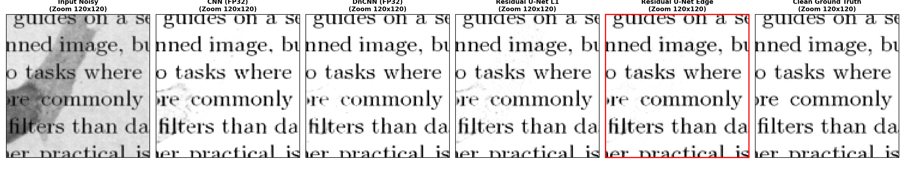
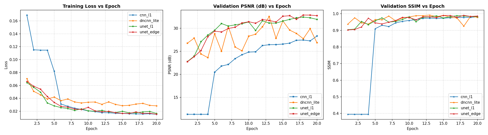

# AIE464 — Text-Preserving Image Denoising

โปรเจกต์ลดสัญญาณรบกวนในภาพเอกสารด้วย PyTorch โดยศึกษาการรักษาขอบตัวอักษร เปรียบเทียบ Shallow CNN, DnCNN-lite และ Residual U-Net ที่ใช้ loss สองแบบ ภาพนำเข้าและผลลัพธ์มีขนาดเท่ากัน: `1 × H × W → 1 × H × W`

**ผลชุดสุดท้าย:** `unet_edge` ได้ PSNR สูงสุด **31.865 dB** ส่วน `dncnn_lite` ได้ SSIM สูงสุด **0.9918** บน Test 24 คู่ภาพจาก 6 กลุ่มเอกสาร ยังไม่มีผล OCR ยืนยันว่าระบบอ่านข้อความได้ดีขึ้น

## ไฟล์สำหรับเปิดดูและทำสไลด์

- [Presentation Brief สำหรับเพื่อนทำสไลด์](docs/PRESENTATION_BRIEF.md)
- [Final Notebook พร้อม outputs การทดลองจริง](mini_project/FINAL_SUBMISSION/aie464-text-preserving-image-denoising-final.ipynb)
- [Benchmark JSON — ตัวเลขเต็มก่อนปัดเศษ](mini_project/results/final/final_test_benchmark.json)
- Artifacts ZIP ต้นฉบับและไฟล์ SHA256 ซึ่งเป็นรหัสตรวจความสมบูรณ์ของไฟล์ อยู่ในเครื่องที่ `mini_project/FINAL_SUBMISSION/aie464_final_artifacts.zip` และ `mini_project/FINAL_SUBMISSION/aie464_final_artifacts.zip.sha256`; ไม่รวมใน Repository อ่านรหัส SHA256 ได้ในส่วนท้ายของหน้านี้

> ชุดนี้เตรียม Final Notebook, Presentation Brief และไฟล์ผลที่ตรวจแล้วสำหรับ GitHub โดยใช้ Relative Path ยังไม่ได้ Push; หลังอนุมัติและ Push แล้วจึงจะเห็นเวอร์ชันนี้บน GitHub ส่วน Dataset, ZIP และ checkpoints เก็บในเครื่อง

## Problem และ Objectives

ภาพเอกสารที่มีคราบและสัญญาณรบกวนทำให้พื้นหลังไม่สม่ำเสมอและรายละเอียดตัวอักษรอ่านยาก การลดสัญญาณรบกวนจึงควรรักษาเส้นขอบตัวอักษรไปพร้อมกัน

1. เปรียบเทียบโมเดลภายใต้ข้อมูลและงบฝึกเดียวกัน
2. ศึกษาผลของ Sobel Edge Loss ซึ่งวัดความต่างของขอบภาพ เมื่อเพิ่มเข้าไปใน L1 Loss ซึ่งวัดความต่างของค่าพิกเซล
3. ประเมินคุณภาพภาพ ความเร็ว และหน่วยความจำบนภาพเอกสารเต็มหน้า

## Dataset

Final Notebook แนบ Kaggle input `thames98451/aie464-denoising-benchmark` และอ่านคู่ภาพจาก `train/` กับ `train_cleaned/` พร้อม `split_manifest.json` ซึ่งกำหนดรายชื่อคู่ภาพในแต่ละชุด

| Split | กลุ่มเอกสารต้นฉบับ | คู่ภาพ Noisy–Clean |
|---|---:|---:|
| Train | 25 | 100 |
| Validation | 5 | 20 |
| Test | 6 | 24 |
| รวม | 36 | 144 |

ตามคำอธิบายใน Final Notebook แต่ละกลุ่มมี 4 noisy variants แบ่งระดับกลุ่มเอกสารก่อน crop เพื่อป้องกัน Data Leakage หรือการที่ข้อมูลเอกสารเดียวกันหลุดไปอยู่ทั้งชุดฝึกและชุดทดสอบ ใช้ Seed 42 ซึ่งเป็นค่าเริ่มต้นของการสุ่ม และทุกโมเดลใช้ Test ชุดเดียวกัน **24 คู่ภาพไม่ได้หมายถึงเอกสารอิสระ 24 หน้า**

ภาพแปลงเป็น Grayscale ช่องเดียวและปรับค่าพิกเซลเป็น `[0, 1]` ฝึกบน random crop 256×256 พิกเซล ส่วน Validation และ Test ประเมินเต็มหน้า

## Models และ Methodology

เปรียบเทียบ 4 configurations จากสถาปัตยกรรม 3 แบบ โดย U-Net สองรายการใช้โครงสร้างเดียวกันและต่างที่ loss:

| Configuration | โครงสร้างใน Final Notebook | Parameters | Loss |
|---|---|---:|---|
| `cnn_l1` | Shallow CNN, 5 convolutions, width 16, Sigmoid output | 7,265 | L1 |
| `dncnn_lite` | DnCNN-lite, 7 convolutions, width 32, BatchNorm | 47,009 | L1 |
| `unet_l1` | Residual U-Net, 3 encoder levels, width 16, skip connections | 487,009 | L1 |
| `unet_edge` | Residual U-Net โครงสร้างเดียวกับ `unet_l1` | 487,009 | L1 + 0.1 × Sobel Edge Loss |

Residual Learning ในที่นี้คือให้โมเดลทำนาย noise แล้วลบออกจากภาพ: `denoised = noisy - predicted_noise` ใช้ใน DnCNN-lite และ U-Net ทั้งสอง ส่วน CNN ทำนายภาพสะอาดโดยตรง U-Net เติมขอบภาพก่อนประมวลผลและตัดกลับเป็นขนาดเดิม

**Final Notebook ใช้ L1 + Sobel Edge Loss โดยไม่มี SSIM loss หรือ Attention เพิ่มเติม** SSIM ใช้เป็นตัวชี้วัดผลเท่านั้น

### Final Notebook กับ Development Pipeline

[Final Notebook](mini_project/FINAL_SUBMISSION/aie464-text-preserving-image-denoising-final.ipynb) เป็นโค้ดทดลองจริงที่มี outputs รองรับตารางผลในหน้านี้ และนิยามโมเดล การฝึก และการประเมินไว้ภายใน Notebook

[`mini_project/src/`](mini_project/src/) เป็น **Development Pipeline** รุ่นพัฒนา มี Architecture ต่างจาก Final Notebook โดยเฉพาะ [`src/models/unet.py`](mini_project/src/models/unet.py) ที่ใช้ Sigmoid output ขณะที่ Final Notebook ใช้ residual output จึงไม่ควรใช้ `src/` แทน Final Notebook แล้วอ้างว่าจะได้ผล Benchmark ชุดนี้ งานจัดเอกสารรอบนี้ไม่ได้ปรับโค้ดสองชุดให้ตรงกัน

อ่านขอบเขตของ source/scripts และเอกสารประวัติได้ที่ [Development Pipeline Guide](mini_project/README.md) Notebook รุ่น `02a`, `03`, `04`, `05` และไฟล์ทดลองอื่นเก็บไว้ในเครื่อง; GitHub แสดง Final Notebook เพียงฉบับเดียว

## Experimental Setup

| รายการ | การทดลองชุดสุดท้าย |
|---|---|
| Hardware ที่บันทึกใน output | Kaggle, Tesla T4 |
| Precision | FP32 — เลขทศนิยม 32 บิต; ไม่ใช้ AMP ในการฝึกชุดนี้ |
| Random seed | 42; reset ก่อนฝึกแต่ละ configuration |
| Training budget | 20 Epochs ต่อ configuration; Epoch คือหนึ่งรอบผ่านข้อมูลฝึก |
| Optimizer | Adam, learning rate `1e-3` |
| Training batch / patch | 1 คู่ / 256×256 พิกเซล; noisy และ clean ใช้พิกัด crop เดียวกัน |
| Gradient clipping | จำกัด gradient norm ที่ 1.0 |
| Validation | ครบ 20 คู่เต็มหน้าทุก Epoch |
| Checkpoint selection | เลือกน้ำหนักโมเดลจาก Validation PSNR สูงสุด |
| Final Test | 24 คู่เต็มหน้าชุดเดียวกัน, batch size 1 |

## Results

ที่มา: [Benchmark JSON](mini_project/results/final/final_test_benchmark.json) ที่คัดลอกตรงจาก Final ZIP ตารางปัด PSNR เป็น 3 ตำแหน่ง, SSIM เป็น 4 ตำแหน่ง, Latency เป็น 2 ตำแหน่ง และ VRAM เป็น 1 ตำแหน่ง

| Configuration | Best Epoch | Test PSNR ↑ (dB) | Test SSIM ↑ | Latency ↓ (ms/page) | Peak VRAM ↓ (MB) |
|---|---:|---:|---:|---:|---:|
| `cnn_l1` | 20 | 27.706 | 0.9810 | 3.65 | 39.8 |
| `dncnn_lite` | 13 | 31.669 | **0.9918** | 9.39 | 67.1 |
| `unet_l1` | 18 | 31.506 | 0.9862 | 6.92 | 116.5 |
| `unet_edge` | 18 | **31.865** | 0.9898 | 6.06 | 116.5 |

PSNR วัดความคลาดเคลื่อนพิกเซลในหน่วย dB และ SSIM วัดความคล้ายของโครงสร้างภาพ; ทั้งสองค่ายิ่งสูงยิ่งดี คำนวณต่อคู่แล้วเฉลี่ย 24 คู่ SSIM ใช้ Gaussian window 11×11, sigma 1.5 และ clamp ภาพเป็น `[0, 1]` ก่อนวัด

เมื่อเทียบ U-Net โครงสร้างเดียวกัน `unet_edge` เพิ่ม PSNR **0.360 dB** และ SSIM **0.0036** จาก `unet_l1` ในชุดทดลองนี้ ส่วน `cnn_l1` ใช้เวลาต่อหน้าน้อยที่สุด ไม่มีโมเดลเดียวที่ดีที่สุดในทุกตัวชี้วัด

Latency จับเวลาหนึ่ง forward ต่อคู่ รวม output clamp และ CUDA synchronization แล้วเฉลี่ย ไม่รวมอ่านไฟล์ ส่งภาพเข้า GPU หรือคำนวณ metrics ไม่มี warm-up หรือการจับเวลาซ้ำหลายรอบต่อภาพ Peak VRAM มาจาก `torch.cuda.max_memory_allocated / 1024**2` ระหว่าง evaluation จึงเป็น MiB ตามสูตรแม้ต้นฉบับใช้ชื่อ MB และไม่ใช่ค่าหน่วยความจำช่วง Training

Validation logs: [CNN](mini_project/results/final/logs/cnn_l1/validation.json), [DnCNN-lite](mini_project/results/final/logs/dncnn_lite/validation.json), [U-Net L1](mini_project/results/final/logs/unet_l1/validation.json), [U-Net Edge](mini_project/results/final/logs/unet_edge/validation.json)

## Visual Evidence

### ภาพเปรียบเทียบเต็มหน้า


แสดง 4 คู่ภาพ Test ตัวอย่าง เรียงคอลัมน์เป็น Input Noisy → CNN → DnCNN → U-Net L1 → U-Net Edge → Clean Ground Truth หรือภาพสะอาดอ้างอิง ไม่ใช่ภาพเปรียบเทียบครบทั้ง 24 คู่

### ภาพขยายบริเวณตัวอักษร



Crop 120×120 พิกเซลจากคู่ภาพตัวอย่างแรก ใช้ตำแหน่งเดียวกันทุกโมเดล เหมาะสำหรับอภิปรายพื้นหลังและเส้นตัวอักษร แต่ภาพตัวอย่างไม่แทนการวัดความถูกต้องของ OCR

### กราฟการฝึกและ Validation



กราฟแสดง Training Loss, Validation PSNR และ Validation SSIM ไม่ใช่ Test ราย Epoch; loss ของ `unet_edge` มีองค์ประกอบเพิ่ม จึงไม่เปรียบเทียบระดับ loss ข้ามสูตรเพื่อจัดอันดับคุณภาพโดยตรง

## วิธีเปิดดูและเตรียมรันซ้ำ

สำหรับทำสไลด์ ใช้ [Presentation Brief](docs/PRESENTATION_BRIEF.md), JSON และภาพข้างต้น เปิดดู saved outputs ใน Final Notebook ได้โดยไม่ต้อง Run All

หากได้รับอนุมัติให้รันซ้ำในภายหลัง:

1. นำสำเนา Final Notebook เข้า Kaggle และตั้ง GPU Tesla T4
2. แนบ input `thames98451/aie464-denoising-benchmark` ที่มีคู่ภาพและ `split_manifest.json` ตามโครงสร้างที่ Notebook ค้นหา
3. Environment ต้องมี PyTorch, NumPy, Pillow, Matplotlib และ IPython ตาม imports; ชุดหลักฐานไม่ได้บันทึกเวอร์ชันครบทุกไลบรารี
4. ตรวจ path discovery ใน CELL 1; output เดิมพบข้อมูลที่ `/kaggle/input/datasets/thames98451/aie464-denoising-benchmark/mini_project/data/raw` และ manifest ภายใต้ `mini_project/outputs/phase1/` ของ input เดียวกัน
5. Run All จะฝึก 4 configurations ใหม่ครบ 20 Epochs แล้วประเมิน Test และ export ZIP; **ไม่ใช่โหมดแสดงผลอย่างเดียว** ใช้พื้นที่ผลลัพธ์แยกจากหลักฐานชุดสุดท้าย เพราะโค้ดเขียนผลและสร้าง ZIP ชื่อเดิม

งานจัดเอกสารนี้ไม่ได้รัน Notebook หรือ Training ซ้ำ และไม่ได้ยืนยันการติดตั้ง environment ใหม่

## Limitations

- ยังไม่มี OCR Character Error Rate/Word Error Rate หรือการประเมินความอ่านง่ายจากมนุษย์ จึงไม่สรุปว่าความแม่นยำ OCR ดีขึ้น
- Test มีเพียง 6 กลุ่มเอกสาร; noisy variants ในกลุ่มเดียวกันไม่ใช่ตัวอย่างอิสระทั้งหมด
- เป็นผลชุดเดียว Seed 42 ไม่มีหลาย seeds หรือช่วงความเชื่อมั่นให้สรุปนัยสำคัญทางสถิติ
- ความเร็วและหน่วยความจำเป็นผล evaluation บน T4, batch 1 ตามวิธีจับเวลาข้างต้น ไม่แทน CPU, Edge Device หรือ Production API
- ไม่พบผลข้าม Dataset ใน Final ZIP; ไม่อ้างว่าทำงานได้กับเอกสารทุกชนิด
- การมี outputs และไฟล์ผลสอดคล้องกันไม่เท่ากับการยืนยันว่ารันซ้ำจาก environment ใหม่แล้วได้ค่าเดิมทุกหลักทศนิยม

## แหล่งหลักฐานและความสมบูรณ์ของสำเนา

ข้อมูลในเอกสารนี้อ้างอิง Final Notebook และ Final ZIP ภายใน `mini_project/FINAL_SUBMISSION/` เท่านั้น ไม่ใช้คะแนนจาก ZIP หรือ Notebook รุ่นเก่า

Final ZIP SHA256:

```text
f7d92b9abb4f81b38afeb940d5e7df3c04ed99a8678bc7a694624d5464ed5d6c
```

`mini_project/results/final/` มีสำเนา 8 ไฟล์: Benchmark JSON 1 ไฟล์, Validation logs 4 ไฟล์ และ PNG 3 ไฟล์ ตรวจว่า byte และ SHA256 ตรงกับแต่ละ entry ใน Final ZIP โดยไม่ได้คัดลอกหรือแก้ checkpoints และไม่ได้เปลี่ยนไฟล์ใน `FINAL_SUBMISSION/`
