# AIE464 — Text-Preserving Image Denoising

โปรเจกต์ลด noise ในภาพเอกสารสแกนด้วย PyTorch โดยต้องเก็บขอบตัวอักษรให้คมอยู่ ภาพเข้าและภาพออกมีขนาดเท่ากัน (`1 × H × W → 1 × H × W`) งานนี้เป็น denoising ไม่ใช่ super-resolution

Final project ต่อยอดจากโมเดล midterm (SmallUNet + Sobel edge loss) โดยมีโจทย์ 2 ข้อ:

1. ทำให้โมเดลทนต่อ noise แบบใหม่ที่ไม่เคยเห็นตอนเทรน (domain shift)
2. ทำให้โมเดลใช้กับ dataset อื่นได้ (cross-dataset)

ทุกโมเดลวัดผลบน test set, metric และ GPU (Colab Tesla T4) ชุดเดียวกัน

## ไฟล์หลัก

| ไฟล์ | คืออะไร |
|---|---|
| [`mini_project/notebooks/final_colab.ipynb`](mini_project/notebooks/final_colab.ipynb) | **Notebook ที่ส่งอาจารย์** มีโค้ด คำอธิบาย output จริงจาก Colab ตารางผล และสรุป ([เปิดใน Colab](https://colab.research.google.com/github/chayanon25/aie464-text-preserving-denoising/blob/main/mini_project/notebooks/final_colab.ipynb)) |
| [`docs/IMPROVEMENT_REPORT.md`](docs/IMPROVEMENT_REPORT.md) | รายงานผลฉบับเต็ม ตารางครบทุกโมเดล ค่า p และ limitations ตัวเลขทั้งหมดในหน้านี้มาจากไฟล์นี้ |
| [`docs/figures/`](docs/figures/) | รูปที่ใช้ในรายงานและสไลด์ |
| [`mini_project/src/`](mini_project/src/) | โค้ด pipeline (dataset, models, losses, train, evaluate, report) |

## ข้อมูล

| ชุด | ใช้ทำอะไร | จำนวน |
|---|---|---|
| Kaggle Denoising Dirty Documents | train / val / test (in-domain) | test 24 ภาพ จากเอกสารต้นฉบับ 6 หน้า |
| Augraphy shift | test เท่านั้น: เอา Kaggle test มาใส่ noise แบบใหม่ (รอยหมึก เงา รอยพับ) ด้วย library Augraphy | 24 ภาพ |
| DIBCO 2017 | test เท่านั้น (cross-dataset): เอกสารเก่าจริง ทั้งแบบพิมพ์และลายมือ | 20 ภาพ |
| DIBCO 2018 + 2019A | fine-tune เท่านั้น ไม่ใช้ปี 2017 เพื่อกัน data leakage | train 16 / val 4 หน้า |

แบ่ง train / val / test ตามหน้าเอกสารก่อนตัดเป็น patch เพื่อไม่ให้หน้าเดียวกันไปอยู่ทั้งชุดเทรนและชุดทดสอบ

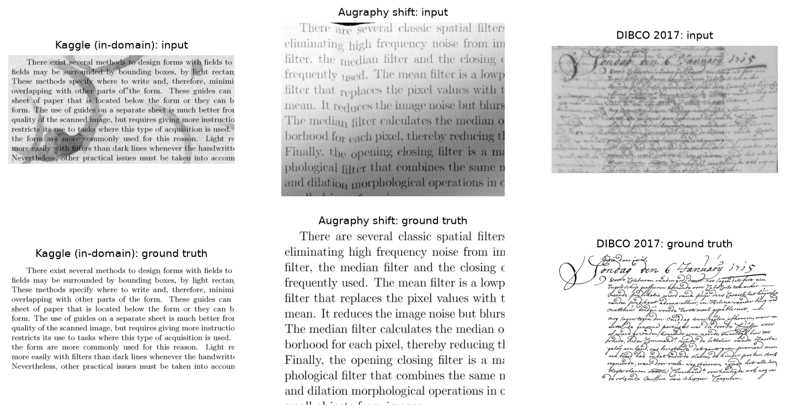

*ซ้ายไปขวา: Kaggle, Augraphy shift, DIBCO 2017 แถวบนเป็นภาพ input แถวล่างเป็นภาพเฉลย*

## Metric

- **PSNR (dB), SSIM:** เทียบ output กับภาพเฉลยทีละ pixel ยิ่งสูงยิ่งดี
- **Text PSNR:** PSNR เฉพาะบริเวณตัวอักษร เพราะพื้นหลังสีขาวกินพื้นที่ส่วนใหญ่ของภาพ PSNR รวมจึงอาจสูงทั้งที่ตัวอักษรเสีย
- **FM, pFM, DRD (DIBCO):** เฉลยของ DIBCO เป็นภาพขาวดำ จึงแปลง output เป็นขาวดำด้วย Otsu ก่อนวัด FM และ pFM ยิ่งสูงยิ่งดี ส่วน DRD ยิ่งต่ำยิ่งดี
- **Wilcoxon signed-rank test:** เทียบสองโมเดลบนภาพเดียวกันทีละคู่ ถ้า p < 0.05 ถือว่าต่างกันอย่างมีนัยสำคัญ

## วิธีการ

**โมเดลหลัก: SmallUNet** (487,009 params) มี encoder 3 ชั้น, skip connection และ residual output (โมเดลทำนาย noise แล้วเอาไปลบออกจาก input)

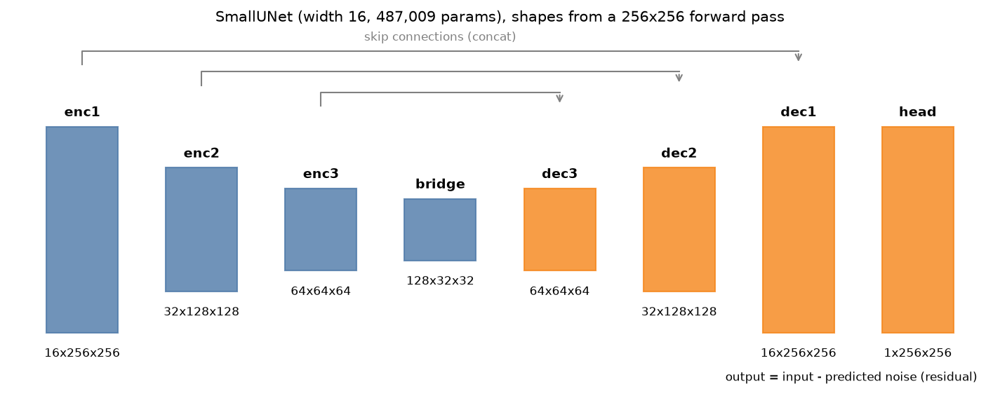

**Edge loss:** `L = L1(pred, gt) + λ · L1(Sobel(pred), Sobel(gt))` โดย Sobel หาขอบตัวอักษรในแนวนอนและแนวตั้ง ทดลอง λ = 0, 0.1 (ค่าหลัก) และ 0.5

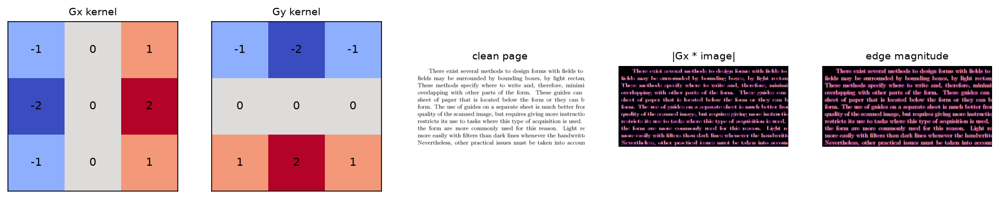

เทคนิคที่เพิ่มหลัง midterm:

| สัปดาห์ | เทคนิค | ทำอะไร |
|---|---|---|
| ทุก job | Augmentation | สุ่มเติม noise หลายแบบลงภาพเทรน (photometric, blur, JPEG, noise) |
| W9 | Pretrained NAFNet | โมเดลใหญ่ (29M params) ที่ pretrain บน SIDD มาแล้ว นำมา fine-tune บน Kaggle |
| W9 | Fine-tune ข้าม dataset | Kaggle → DIBCO แบบ full และแบบ freeze encoder |
| W10 | Knowledge Distillation | ให้ CNN เล็ก (7,265 params) เรียนจาก output ของ U-Net |
| W12 | LoRA | แช่ weights เดิมไว้ แล้วเทรนแค่ adapter เล็ก ๆ (rank 4 / 8) |

ทุก job ใช้ seed 42 มี `unet_edge_aug` ตัวเดียวที่รันเพิ่มด้วย seed 43 และ 44

## ผลการทดลอง

### 1. In-domain (Kaggle test)

| โมเดล | PSNR (dB) |
|---|---|
| noisy input | 16.30 |
| midterm U-Net edge | 31.84 |
| U-Net edge + aug (λ = 0.1) | 31.19 |
| U-Net aug, λ = 0.5 | **32.15** |
| NAFNet fine-tuned | 31.19 |

ตัวที่ดีที่สุดสูงกว่า midterm แต่**ไม่มีนัยสำคัญ** (p = 0.375) แปลว่าบน noise แบบเดิม โมเดลใหม่ไม่ได้ดีกว่า midterm อย่างชัดเจน

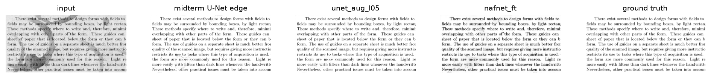
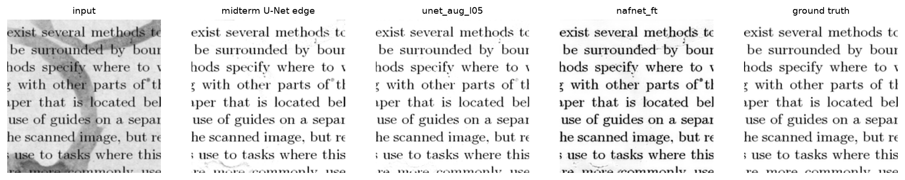

*ทุกโมเดลลบคราบพื้นหลังได้ใกล้เคียงกัน ส่วน `nafnet_ft` ให้ตัวอักษรหนาและเข้มกว่า ground truth*

### 2. Domain shift (Augraphy)

| โมเดล | PSNR (dB) | Text PSNR (dB) |
|---|---|---|
| noisy input | 9.93 | 9.09 |
| midterm U-Net edge | 14.53 | 5.93 |
| NAFNet fine-tuned | 17.16 | 10.73 |
| U-Net edge + aug | **17.48** | **10.89** |

Augmentation ทำให้ทนต่อ noise ที่ไม่เคยเห็นได้ชัดเจน (median +2.74 dB, p < 0.001) และผลนี้คงที่ทั้ง 3 seeds (17.41–17.48 dB) **นี่คือผลที่ชัดที่สุดของงาน**

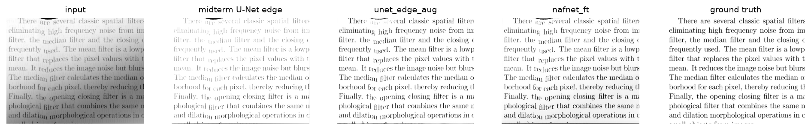
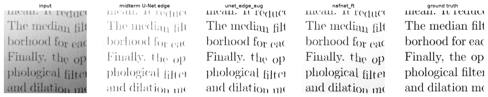

*midterm U-Net ทำให้ตัวอักษรขาดและจาง ส่วน `unet_edge_aug` เก็บเส้นตัวอักษรได้คมใกล้ ground truth ทุกโมเดลยังเหลือบรรทัดที่บิดโค้งจาก Augraphy อยู่ เพราะงาน denoising ไม่ได้แก้รูปทรงเรขาคณิต*

### 3. Cross-dataset (DIBCO 2017)

| โมเดล | FM | DRD |
|---|---|---|
| Otsu บนภาพดิบ | 78.04 | 14.90 |
| U-Net edge + aug (ยังไม่ fine-tune) | 61.91 | 12.23 |
| U-Net fine-tune, freeze encoder | 77.53 | 6.94 |
| U-Net fine-tune, full | 84.36 | 6.64 |
| U-Net fine-tune, LoRA r8 | 84.38 | 6.86 |
| NAFNet fine-tune, full | **87.98** | **5.05** |

- ถ้ายังไม่ fine-tune U-Net แพ้ Otsu เพราะโมเดลที่เรียนจาก Kaggle ลบหมึกจาง ๆ ของเอกสารเก่าทิ้งไปด้วย
- fine-tune ด้วยข้อมูลแค่ 16 ภาพ FM ขึ้นจาก 61.9 เป็น 84.4 (p < 0.001)
- LoRA r8 ได้ผลเท่า full fine-tune (p = 1.000) โดยเทรนเพิ่มแค่ 63,304 params
- NAFNet ดีกว่า U-Net full fine-tune (+3.80 FM, p = 0.006)

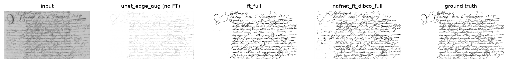
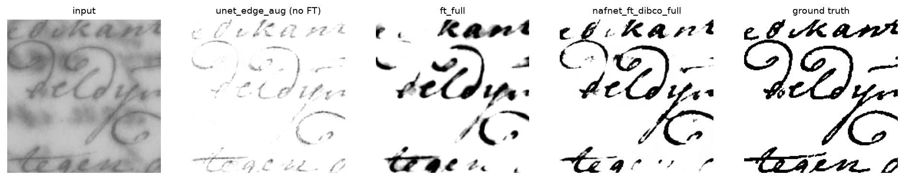

*ถ้าไม่ fine-tune หมึกจางจะถูกลบทิ้ง `ft_full` กู้ตัวอักษรกลับมาได้แต่เส้นหนาเป็นก้อน ส่วน `nafnet_ft_dibco_full` ได้เส้นบางใกล้ ground truth กว่า แต่ในภาพนี้ตัวอักษรบางช่วงขาด FM เฉลี่ยที่สูงกว่าจึงไม่ได้แปลว่าดีกว่าทุกภาพ*

### 4. Catastrophic forgetting

หลัง fine-tune บน DIBCO PSNR บน Kaggle ตกจาก 31.19 dB เหลือ 20.03–22.98 dB ทุกวิธี LoRA ก็ไม่ได้ช่วยกันลืม เพราะตอนใช้งาน adapter ยังถูกบวกเข้ากับ weights ถ้าจะใช้งานจริงต้องเก็บโมเดลหรือ adapter แยกตาม domain

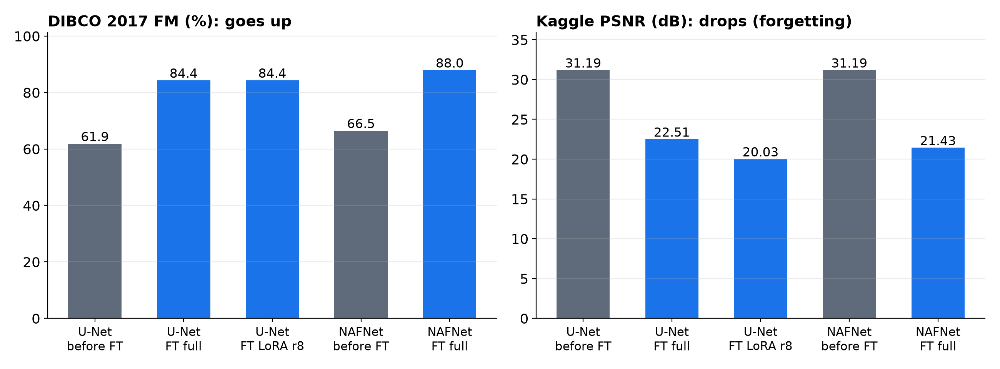

### 5. Knowledge Distillation และความเร็ว

ภาพ 540×420, batch 1, Tesla T4, ค่า median จาก 50 รอบ

| โมเดล | Params | Kaggle PSNR (dB) | Latency (ms) |
|---|---|---|---|
| midterm CNN | 7,265 | 27.71 | 3.8 |
| KD CNN | 7,265 | 28.84 | 4.0 |
| U-Net edge + aug | 487,009 | 31.19 | 8.8 |
| NAFNet fine-tuned | 29,159,715 | 31.19 | 140.6 |

- KD ทำให้ CNN เล็กดีขึ้น +1.15 dB (median, p < 0.001) โดยขนาดและความเร็วเท่าเดิม
- NAFNet ได้ PSNR บน Kaggle เท่ากับ U-Net แต่ช้ากว่าราว 16 เท่า

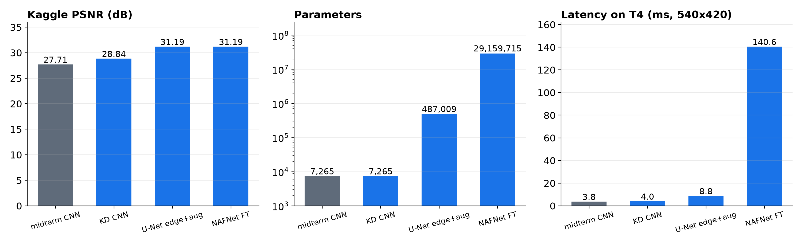

### Ablation: edge loss เทียบกับ seed

- λ = 0 ได้ 31.48 dB และ λ = 0.5 ได้ 32.15 dB
- แต่แค่เปลี่ยน seed (42, 43, 44) ผลก็แกว่งอยู่ที่ 31.19–31.64 dB ต่างกันได้ 0.45 dB
- ความต่างจาก λ มีขนาดพอ ๆ กับความแกว่งจาก seed จึง**ยังสรุปไม่ได้**ว่า edge loss ช่วยเพิ่ม PSNR บน Kaggle

## สรุป

1. **Augmentation** ช่วยเรื่อง domain shift ได้ชัด: +2.95 dB บน Augraphy (17.48 เทียบ 14.53) แต่บน Kaggle ไม่ได้ต่างจาก midterm อย่างมีนัยสำคัญ
2. **Fine-tune** ด้วยข้อมูล 16 ภาพ ทำให้ใช้กับ dataset ใหม่ได้ (FM 61.9 → 84.4, NAFNet 88.0) และ LoRA ได้ผลเท่า full แต่ทุกวิธีลืมงานเดิม
3. **Knowledge Distillation** ทำให้โมเดลเล็กดีขึ้น 1.13 dB (28.84 เทียบ 27.71) โดยไม่เสียความเร็ว

## Limitations

- Kaggle test 24 ภาพมาจากเอกสารแค่ 6 หน้า ภาพจึงไม่อิสระต่อกันจริง ค่า p อาจดูดีเกินจริง
- มีหลาย seed เฉพาะ `unet_edge_aug` ความต่างระหว่างโมเดลที่น้อยกว่าราว 0.5 dB จึงจัดอันดับไม่ได้
- pFM และ DRD เขียนเอง ยังไม่ได้เทียบกับ evaluation tool ทางการของ DIBCO
- Latency ของ LoRA วัดตอนยังไม่ merge adapter เข้า weights จึงช้ากว่าความจริง
- ยังไม่ได้วัด OCR accuracy ว่าหลัง denoise แล้วอ่านตัวอักษรได้ถูกต้องขึ้นจริงหรือไม่
- License ของ DIBCO ไม่ได้ระบุชัด ใช้เพื่อการศึกษาเท่านั้น

## วิธีเปิดดูและรัน

- **ดูผลอย่างเดียว:** เปิด notebook ผ่านลิงก์ Colab ด้านบน output จาก Colab บันทึกไว้แล้ว ไม่ต้อง Run All
- **รันซ้ำ:** ต้องใช้ GPU (Colab T4) และ checkpoint/ข้อมูลใน Google Drive (`MyDrive/AIE464_runs`) ซึ่งไม่ได้อยู่ใน repository นี้เพราะไฟล์ใหญ่ ขั้นตอนอยู่ใน notebook
- **โค้ดและ unit test บนเครื่อง:**

```bash
cd mini_project
python -m venv .venv && .venv/bin/pip install -r requirements-dev.txt
.venv/bin/python -m pytest
```

## ผล midterm (สำหรับเทียบ)

ตอน midterm เทียบ 4 configurations บน Kaggle test ด้วย seed 42 เทรน 20 epochs:

| Configuration | PSNR (dB) | SSIM |
|---|---|---|
| `cnn_l1` | 27.71 | 0.981 |
| `dncnn_lite` | 31.67 | 0.992 |
| `unet_l1` | 31.51 | 0.986 |
| `unet_edge` | 31.84 | 0.989 |

ค่าข้างบนเป็นค่าที่นำ checkpoint ของ midterm มาประเมินซ้ำด้วยโค้ดชุด final ส่วนไฟล์ midterm เดิมอยู่ที่ [`mini_project/FINAL_SUBMISSION/`](mini_project/FINAL_SUBMISSION/) และ [`mini_project/results/final/`](mini_project/results/final/) (ในไฟล์เดิม `unet_edge` ได้ 31.865 dB ซึ่งมาจากอีกรันหนึ่งที่ไม่มี checkpoint เหลืออยู่)
