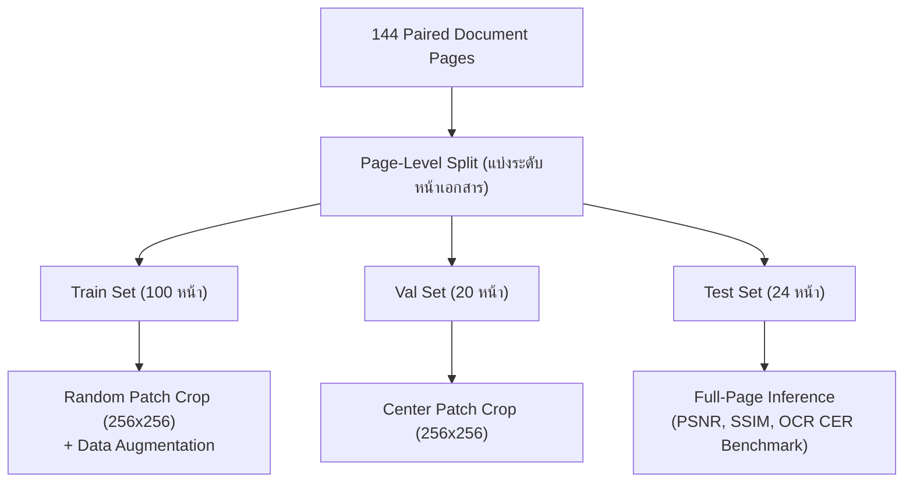

# Dataset Specification (docs/DATASET.md)

เอกสารฉบับนี้สรุปรายละเอียดชุดข้อมูล มาตรการความปลอดภัยของข้อมูล และกฎการป้องกัน Data Leakage สำหรับโปรเจกต์ **Text-Preserving Image Denoising**

---

## 1. ชุดข้อมูลหลัก (Primary Dataset): Kaggle Denoising Dirty Documents

- **แหล่งที่มา:** [Kaggle: Denoising Dirty Documents](https://www.kaggle.com/c/denoising-dirty-documents)
- **ขนาดดาวน์โหลด:** ประมาณ **58.8 MB** (เบามาก เหมาะอย่างยิ่งกับ Colab T4)
- **การจัดเก็บไฟล์ต้นทาง:**
  - `train.zip` $\rightarrow$ ภาพเอกสารที่มี Noise จำนวน 144 ภาพ
  - `train_cleaned.zip` $\rightarrow$ ภาพเอกสาร Clean Ground Truth จำนวน 144 ภาพ (ชื่อไฟล์ตรงกัน 1:1)
  - `test.zip` $\rightarrow$ ภาพเอกสารที่มี Noise จำนวน 72 ภาพ (**ไม่มี Ground Truth สาธารณะ**)

---

## 2. การจำแนกข้อเท็จจริง สมมติฐาน และความเสี่ยง (Verified / Assumptions / Risks)

| หมวดหมู่ | รายละเอียด |
|---|---|
| **[Verified Fact]** | • โฟลเดอร์ `train` และ `train_cleaned` มีคู่ภาพตรงกัน 144 ภาพจริง ขนาดภาพประมาณ $420 \times 540$ พิกเซล • ภาพใน `test.zip` ของ Kaggle ไม่มีเฉลย Ground Truth เผยแพร่ • Noise ในชุดนี้เป็น **Non-Gaussian Degradation** จริง (เช่น คราบกาแฟ, รอยยับกระดาษ, คราบหยดน้ำ, รอยหมึกซึม) |
| **[Assumption]** | • การนำ 144 หน้าที่มีเฉลยมาแบ่งเป็น **Train 100 หน้า, Validation 20 หน้า, Test 24 หน้า** จะเพียงพอสำหรับการเทรน U-Net ให้ลู่เข้าได้เมื่อใช้เทคนิค Random Patch Cropping ($256 \times 256$ พิกเซล) |
| **[Risk & Challenge]** | • **Data Leakage Risk:** หากหั่น Patch ก่อนแบ่งชุดข้อมูล โมเดลจะจำลักษณะกระดาษและฟอนต์เดียวกันได้ ทำให้คะแนน Overfit เกินจริง • **OCR Limitation:** ในบางหน้าที่ตัวอักษรจางมากตั้งแต่ต้นฉบับ Tesseract อาจอ่านไม่ออกตั้งแต่ Ground Truth จึงควรคัดประเมิน CER เฉพาะหน้าที่มีตัวหนังสือชัดเจน |

---

## 3. ชุดข้อมูลสำรอง (Secondary / Backup Datasets)

1. **RVL-CDIP Restoration (Hugging Face):**
   - **แหล่งที่มา:** [`mkenfenheuer/rvl-cdip-restoration`](https://huggingface.co/datasets/mkenfenheuer/rvl-cdip-restoration)
   - **ลักษณะ:** 10,000 คู่ภาพ ขนาด $512 \times 512$ RGB (เก็บเป็น raw numpy bytes ใน Parquet)
   - **การใช้งาน:** ใช้เป็น Dataset สำรองกรณีต้องการทดสอบแบบ Zero-Shot ข้ามโดเมน
2. **ShabbyPages (GitHub / Augraphy):**
   - **แหล่งที่มา:** [`sparkfish/shabby-pages`](https://github.com/sparkfish/shabby-pages) (arXiv:2303.09339)
   - **ลักษณะ:** ชุดข้อมูลสังเคราะห์ความเสื่อมสภาพของเอกสารขนาดใหญ่ (~6,000 หน้า)

---

## 4. กฎเหล็กการป้องกัน Data Leakage (Leakage Prevention Protocol)

1. **ห้าม Crop ก่อนแบ่ง Split โดยเด็ดขาด:** ต้องแยกรายชื่อไฟล์ (IDs) ของหน้าเอกสารให้เสร็จสิ้นก่อนส่งเข้า DataLoader
2. **Deterministic Split:** ใช้ Seed คงที่ในการแบ่งไฟล์ (เช่น `train_test_split(..., random_state=42)`)
3. **การทดสอบบน Test Set:** ในขั้นตอนประเมินผลตัวชี้วัดสุดท้าย ต้องประเมินบนหน้าเอกสารเต็ม (Full Page) ของ Test Set ทั้ง 24 หน้า เพื่อสะท้อนการใช้งานจริง

---

## 5. รายการตรวจสอบคุณภาพข้อมูล (Verification Checklist สำหรับ Agent)

ก่อนเริ่มรันสคริปต์เทรนหรือประเมินผล Agent ต้องตรวจเช็กสิ่งต่อไปนี้:
- [ ] ภาพ Input (`noisy`) และ Target (`clean`) มีขนาดกว้าง $\times$ สูง ตรงกัน
- [ ] ค่า Pixel Intensity ถูกปรับสเกลให้อยู่ในช่วง $[0.0, 1.0]$ ชนิด `torch.float32`
- [ ] จำนวน Channel ตรงกัน (แนะนำแปลงเป็น Grayscale 1-channel หรือ RGB 3-channel ให้เป็นมาตรฐานเดียวกันทั้งโปรเจกต์)
- [ ] Test Set 24 หน้าต้องไม่ถูกนำไปใช้ในขั้นตอน Hyperparameter Tuning ใด ๆ
