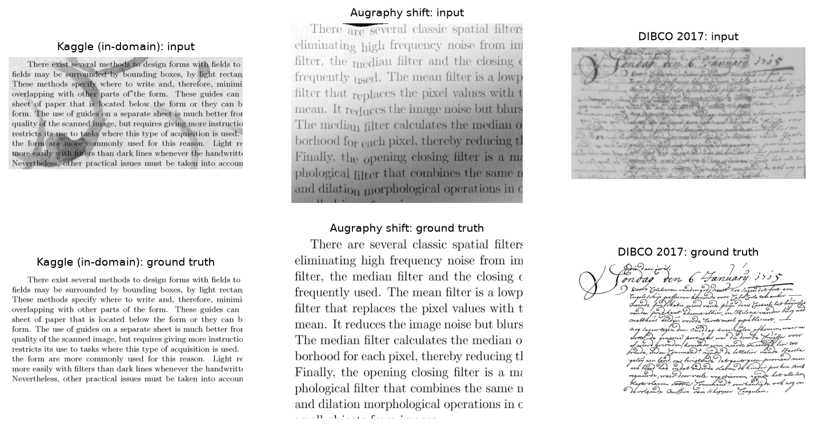
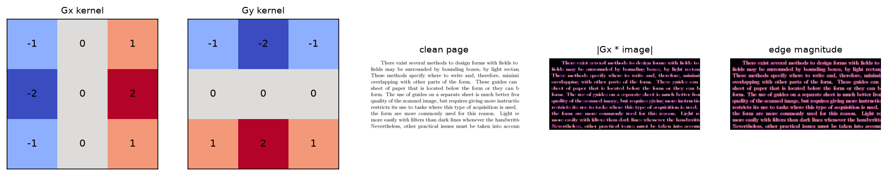
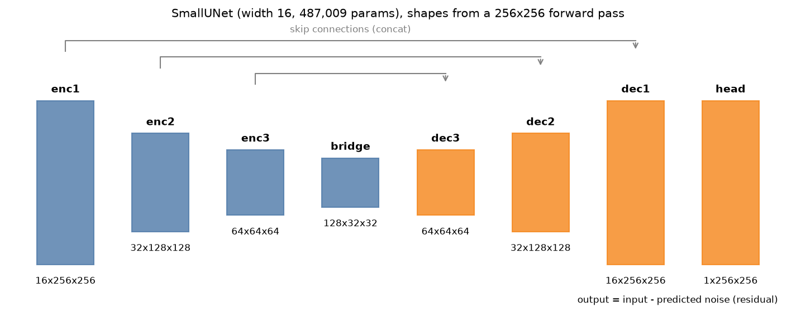
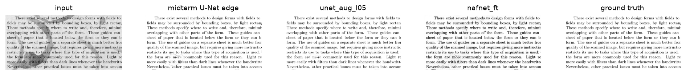
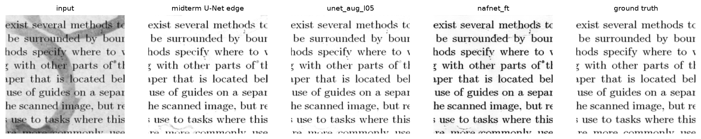
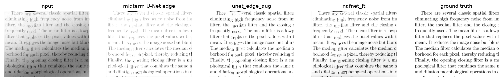
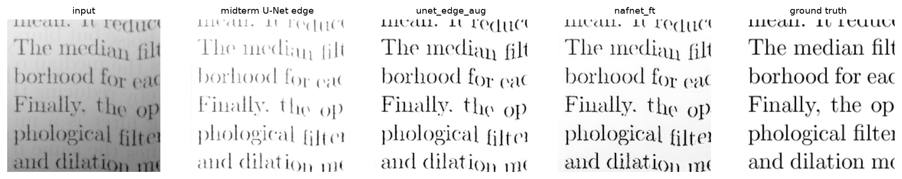
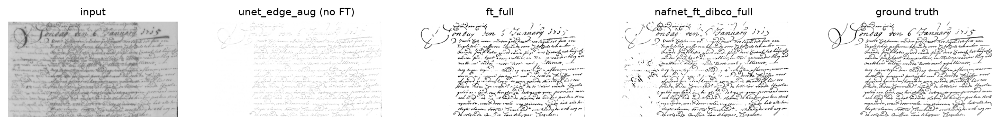
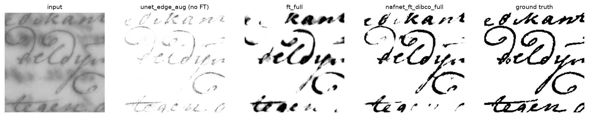
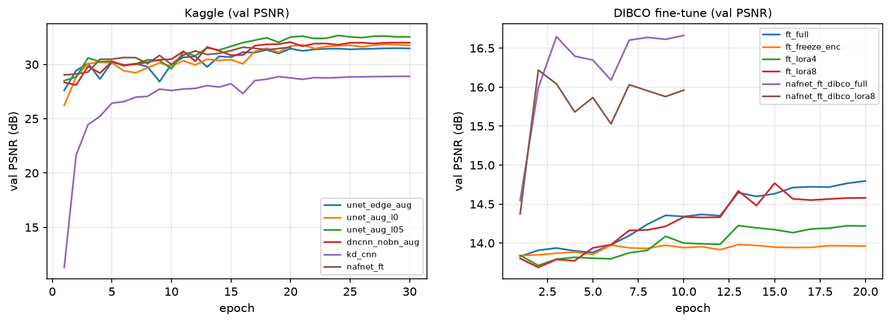

# AIE464 Final: Improvement Report (Text-Preserving Image Denoising)

อัปเดต: 2026-11-23 | โค้ด: `75664d9` (เทรนและประเมินผล) | GPU: Google Colab Tesla T4

ตารางทั้งหมดสร้างจาก `mini_project/src/report.py` โดยใช้ผลประเมินรายภาพใน `mini_project/outputs/final/colab/` ส่วน figure สร้างจาก `mini_project/tools/make_figures.py`

---

## 1. เป้าหมาย

- ปรับปรุงโมเดล denoise เอกสารจาก midterm ด้วยเทคนิคหลัง midterm (W9, W10, W12) โดยเทียบกับโมเดลเดิมแบบ same circumstance คือใช้ test set ชุดเดียวกัน วิธีวัดผลเดียวกัน และ GPU เดียวกัน
- ทดสอบความทนทานเมื่อข้อมูลเปลี่ยน 2 แบบ:
  1. **Augraphy shift:** ภาพ test ของ Kaggle ที่ใส่ความเสียหายแบบใหม่ที่โมเดลไม่เคยเห็น
  2. **DIBCO 2017:** dataset อื่น เป็นเอกสารเก่าจริงทั้งแบบพิมพ์และลายมือ
- ขนาด input เท่ากับ output เสมอ ($H \times W \rightarrow H \times W$) และไม่ใช่งาน super-resolution

## 2. ข้อมูล

| ชุด | ใช้ทำอะไร | จำนวน | วิธีวัด |
|---|---|---|---|
| Kaggle Denoising Dirty Documents | train / val / **test (in-domain)** | test 24 ภาพจาก 6 หน้าต้นฉบับ แบ่งระดับหน้าเพื่อกัน data leakage | PSNR, SSIM, text PSNR (PSNR เฉพาะบริเวณตัวอักษร) |
| Augraphy shift | test เท่านั้น | 24 ภาพ สร้างจาก Kaggle test แบบ deterministic | เหมือน Kaggle |
| DIBCO 2017 | fine-tune + **test (cross-dataset)** | test 20 ภาพ (printed 10, handwritten 10) | binarize ด้วย Otsu แล้ววัด FM, pFM, PSNR, DRD |

- **FM (F-measure):** วัดว่าพิกเซลหมึกที่ทำนายตรงกับ GT แค่ไหน ยิ่งสูงยิ่งดี
- **pFM:** F-measure แบบดูโครงเส้นตัวอักษร (skeleton)
- **DRD:** วัดความผิดเพี้ยนที่สายตามนุษย์สังเกตได้ **ยิ่งต่ำยิ่งดี**

## 3. Sobel คืออะไร (ใช้ใน edge loss)

Sobel คือ kernel ขนาด 3×3 ที่ใช้หาความเปลี่ยนแปลงของความสว่างในแนวนอน (Gx) และแนวตั้ง (Gy) ขอบตัวอักษรจะมีค่าสูง

ใน loss เราเทียบ edge map ของภาพที่โมเดลทำนายกับของ GT ด้วย L1 เพื่อบังคับให้โมเดลรักษาขอบตัวอักษรไว้:

`loss = L1(pred, gt) + λ · L1(Sobel(pred), Sobel(gt))`

ค่า λ ที่ทดลองคือ 0, 0.1 (ค่าหลัก) และ 0.5

## 4. โครงสร้าง U-Net จริง

shape ทุกชั้นในภาพมาจากการรัน `SmallUNet` จริงบนภาพขนาด 256×256 ผ่าน forward hook

- **Encoder:** 3 ชั้น แต่ละชั้นลดขนาดลงครึ่งหนึ่งด้วย max pool
- **Decoder:** ขยายกลับด้วย nearest upsampling แล้วต่อ (concat) กับ skip connection จาก encoder
- **Output:** โมเดลทำนาย noise แล้วนำไปลบออกจากภาพ input (residual)
- ขนาดรวม 487,009 params

## 5. เทคนิคหลัง midterm ที่ใช้

| สัปดาห์ | เทคนิค | Job |
|---|---|---|
| W9 | Transfer learning / fine-tune ข้าม dataset (Kaggle → DIBCO): full FT และ freeze encoder | `ft_full`, `ft_freeze_enc`, `nafnet_ft_dibco_full` |
| W9 | ใช้ pretrained model ภายนอก: NAFNet ที่เทรนบน SIDD มาแล้ว ทดสอบ zero-shot แล้ว fine-tune บน Kaggle | `nafnet_zeroshot`, `nafnet_ft` |
| W10 | Knowledge Distillation: teacher `unet_edge_aug` → student ShallowCNN (7k params) | `kd_cnn` |
| W12 | Parameter-efficient fine-tune: LoRA บน conv (rank 4 / 8) | `ft_lora4`, `ft_lora8`, `nafnet_ft_dibco_lora8` |
| ทุก job | Augmentation (photometric, blur, JPEG, noise), cosine LR, AMP, gradient clipping | `*_aug` |

Budget ที่อนุมัติหลัง pilot มีดังนี้:
- UNet / DnCNN / KD: 30 epochs × 2,000 samples
- Fine-tune DIBCO: 20 epochs × 1,000 samples
- `nafnet_ft`: 20 epochs × 1,000 samples
- NAFNet → DIBCO: 10 epochs × 1,000 samples

ทุก job ใช้ seed 42 ยกเว้น `unet_edge_aug_s43` และ `unet_edge_aug_s44`

## 6. ตารางผล

### 6.1 In-domain (Kaggle test, 24 ภาพ)

ค่า `midterm_*` คือ checkpoint ของ midterm ที่นำมาประเมินซ้ำด้วยโค้ดชุดเดียวกัน

| model | PSNR (dB) | SSIM | text PSNR (dB) |
|---|---|---|---|
| midterm_cnn_l1 | 27.71 | 0.981 | 21.59 |
| kd_cnn | 28.84 | 0.982 | 23.42 |
| midterm_dncnn_lite | 31.67 | 0.992 | 25.53 |
| dncnn_nobn_aug | 31.94 | 0.991 | 26.32 |
| midterm_unet_l1 | 31.51 | 0.986 | 25.40 |
| midterm_unet_edge | 31.84 | 0.989 | 25.44 |
| unet_edge_aug | 31.19 | 0.990 | 25.95 |
| unet_edge_aug_s43 | 31.37 | 0.990 | 25.56 |
| unet_edge_aug_s44 | 31.64 | 0.992 | 26.06 |
| unet_aug_l0 | 31.48 | 0.991 | 26.10 |
| unet_aug_l05 | 32.15 | 0.992 | 26.37 |
| nafnet_zeroshot | 14.97 | 0.781 | 12.24 |
| nafnet_ft | 31.19 | 0.990 | 25.20 |
| noisy input | 16.30 | 0.849 | 20.70 |
| classical_median3 | 14.29 | 0.704 | 9.91 |
| classical_sauvola | 15.53 | 0.866 | 11.10 |
| classical_otsu | 15.21 | 0.867 | 11.10 |

> `midterm_unet_edge` ได้ 31.84 dB ตรงกับ `backups/.../final_test_benchmark.json` ส่วนค่า 31.865 dB ใน `results/final/` มาจากอีกรันหนึ่งที่ไม่มี checkpoint เหลืออยู่ จึงรายงานไว้ทั้งสองค่า

### 6.2 Domain shift (Augraphy, 24 ภาพ)

| model | PSNR (dB) | SSIM | text PSNR (dB) |
|---|---|---|---|
| midterm_cnn_l1 | 15.30 | 0.728 | 6.95 |
| kd_cnn | 16.55 | 0.800 | 9.05 |
| midterm_dncnn_lite | 14.85 | 0.711 | 6.46 |
| dncnn_nobn_aug | 16.72 | 0.810 | 9.35 |
| midterm_unet_l1 | 14.84 | 0.718 | 6.33 |
| midterm_unet_edge | 14.53 | 0.698 | 5.93 |
| unet_edge_aug | 17.48 | 0.850 | 10.89 |
| unet_edge_aug_s43 | 17.41 | 0.848 | 10.70 |
| unet_edge_aug_s44 | 17.41 | 0.846 | 10.70 |
| unet_aug_l0 | 17.54 | 0.850 | 10.96 |
| unet_aug_l05 | 17.16 | 0.840 | 10.30 |
| nafnet_zeroshot | 9.67 | 0.537 | 7.83 |
| nafnet_ft | 17.16 | 0.845 | 10.73 |
| noisy input | 9.93 | 0.614 | 9.09 |
| classical_median3 | 9.58 | 0.494 | 7.09 |
| classical_sauvola | 14.55 | 0.772 | 8.08 |
| classical_otsu | 4.23 | 0.403 | 8.71 |

### 6.3 Cross-dataset (DIBCO 2017, 20 ภาพ)

| model | FM all | FM printed | FM handwritten | pFM | PSNR | DRD (lower better) |
|---|---|---|---|---|---|---|
| Otsu on raw input | 78.04 | 83.93 | 72.16 | 80.52 | 13.96 | 14.90 |
| classical_sauvola | 77.64 | 79.55 | 75.73 | 87.16 | 14.73 | 7.28 |
| midterm_unet_edge | 62.37 | 70.87 | 53.86 | 72.29 | 13.32 | 10.21 |
| unet_edge_aug | 61.91 | 63.59 | 60.22 | 74.19 | 12.80 | 12.23 |
| nafnet_zeroshot | 76.50 | 82.45 | 70.56 | 78.54 | 13.46 | 16.42 |
| nafnet_ft | 66.53 | 70.06 | 63.00 | 75.55 | 13.02 | 11.77 |
| ft_full | 84.36 | 82.47 | 86.25 | 87.30 | 15.71 | 6.64 |
| ft_freeze_enc | 77.53 | 82.66 | 72.40 | 82.96 | 15.23 | 6.94 |
| ft_lora4 | 82.86 | 80.78 | 84.93 | 86.02 | 15.46 | 7.11 |
| ft_lora8 | 84.38 | 82.56 | 86.21 | 86.70 | 15.54 | 6.86 |
| nafnet_ft_dibco_full | 87.98 | 88.09 | 87.86 | 90.71 | 16.89 | 5.05 |
| nafnet_ft_dibco_lora8 | 85.28 | 86.59 | 83.98 | 90.24 | 16.04 | 5.70 |

### 6.4 Fine-tune และการลืมงานเดิม (forgetting)

| model | DIBCO FM | DIBCO DRD | Kaggle PSNR (forgetting) |
|---|---|---|---|
| unet_edge_aug | 61.91 | 12.23 | 31.19 |
| ft_full | 84.36 | 6.64 | 22.51 |
| ft_freeze_enc | 77.53 | 6.94 | 21.53 |
| ft_lora4 | 82.86 | 7.11 | 21.20 |
| ft_lora8 | 84.38 | 6.86 | 20.03 |
| nafnet_ft | 66.53 | 11.77 | 31.19 |
| nafnet_ft_dibco_full | 87.98 | 5.05 | 21.43 |
| nafnet_ft_dibco_lora8 | 85.28 | 5.70 | 22.98 |

### 6.5 Efficiency (ภาพ 540×420, batch 1, Tesla T4, median จาก 50 รอบ)

| model | params | median ms (540x420, T4) | peak VRAM MB |
|---|---|---|---|
| unet_edge_aug | 487,009 | 8.8 | 107 |
| nafnet_ft | 29,159,715 | 140.6 | 375 |
| dncnn_nobn_aug | 46,849 | 12.0 | 57 |
| unet_aug_l0 | 487,009 | 9.3 | 107 |
| unet_aug_l05 | 487,009 | 9.3 | 107 |
| unet_edge_aug_s43 | 487,009 | 9.2 | 107 |
| unet_edge_aug_s44 | 487,009 | 9.4 | 107 |
| kd_cnn | 7,265 | 4.0 | 31 |
| ft_full | 487,009 | 9.6 | 107 |
| ft_freeze_enc | 487,009 | 9.5 | 107 |
| ft_lora4 | 518,661 | 17.6 | 133 |
| ft_lora8 | 550,313 | 18.1 | 133 |
| nafnet_ft_dibco_full | 29,159,715 | 154.6 | 375 |
| nafnet_ft_dibco_lora8 | 30,131,731 | 212.5 | 491 |
| midterm_cnn_l1 | 7,265 | 3.8 | 31 |
| midterm_dncnn_lite | 47,009 | 11.9 | 57 |
| midterm_unet_l1 | 487,009 | 8.6 | 107 |
| midterm_unet_edge | 487,009 | 8.9 | 107 |
| nafnet_zeroshot | 29,159,715 | 136.1 | 375 |

LoRA แบบ r4 เพิ่มพารามิเตอร์ 31,652 ตัว และ r8 เพิ่ม 63,304 ตัว latency สูงขึ้นเพราะยังไม่ได้ merge น้ำหนัก LoRA กลับเข้า conv เดิม ถ้า merge แล้ว latency จะเท่ากับ U-Net ปกติ แต่ยังไม่ได้วัดจริง

### 6.6 ทดสอบนัยสำคัญ (paired Wilcoxon signed-rank, two-sided)

| A | B | test set | metric | n | median(A-B) | p (two-sided) |
|---|---|---|---|---|---|---|
| unet_edge_aug | midterm_unet_edge | kaggle_test | psnr | 24 | -0.39 | 0.121 |
| unet_aug_l05 | midterm_unet_edge | kaggle_test | psnr | 24 | 0.46 | 0.375 |
| dncnn_nobn_aug | midterm_dncnn_lite | kaggle_test | psnr | 24 | -0.02 | 0.406 |
| kd_cnn | midterm_cnn_l1 | kaggle_test | psnr | 24 | 1.15 | <0.001 |
| nafnet_ft | unet_edge_aug | kaggle_test | psnr | 24 | 0.18 | 1.000 |
| unet_edge_aug | midterm_unet_edge | augraphy_shift | psnr | 24 | 2.74 | <0.001 |
| ft_full | unet_edge_aug | dibco2017 | fm | 20 | 17.06 | <0.001 |
| ft_lora8 | ft_full | dibco2017 | fm | 20 | 0.16 | 1.000 |
| nafnet_ft_dibco_full | ft_full | dibco2017 | fm | 20 | 3.80 | 0.006 |

## 7. ภาพเชิงคุณภาพ

## 8. ข้อสรุปที่มีตัวเลขรองรับ

1. **Augmentation ไม่ได้ทำให้ผล in-domain ดีขึ้นอย่างมีนัยสำคัญ แต่ทำให้ทนต่อ domain shift ได้ชัดเจน**
   - บน Kaggle: `unet_aug_l05` ได้ 32.15 dB และ midterm ได้ 31.84 dB (p=0.375) ส่วน `unet_edge_aug` ได้ 31.19 dB (p=0.121)
   - บน Augraphy: `unet_edge_aug` ได้ 17.48 dB และ midterm ได้ 14.53 dB ต่างกัน median +2.74 dB (p<0.001) และ text PSNR เพิ่มจาก 5.93 เป็น 10.89 dB
   - ผลนี้คงที่ทั้ง 3 seeds ได้ 17.41–17.48 dB
2. **ความแปรปรวนจาก seed มีขนาดพอ ๆ กับความต่างระหว่างโมเดลบน Kaggle**
   - `unet_edge_aug` 3 seeds ได้ 31.19 / 31.37 / 31.64 dB ช่วงกว้าง 0.45 dB
   - ส่วนต่างที่เล็กกว่านี้ เช่น λ=0 เทียบ 0.1 เทียบ 0.5 จึงยังสรุปไม่ได้
3. **Knowledge Distillation (W10) ได้ผลชัดสำหรับโมเดลเล็ก**
   - `kd_cnn` ได้ 28.84 dB และ midterm CNN ได้ 27.71 dB (+1.15 dB median, p<0.001)
   - ขนาดเท่าเดิมที่ 7,265 params และใช้เวลา 4.0 ms
4. **โมเดลที่ไม่ได้ fine-tune ทำงานบน DIBCO ได้แย่กว่า Otsu บนภาพดิบ**
   - `unet_edge_aug` ได้ FM 61.9 และ Otsu บนภาพดิบได้ 78.0
   - โมเดลที่เรียนจาก Kaggle ลบหมึกจาง ๆ ของเอกสารเก่าทิ้งไป
5. **Fine-tune (W9) แก้ปัญหานี้ได้**
   - `ft_full` ได้ FM 84.4 จากเดิม 61.9 (+17.1 median, p<0.001) และ DRD ลดจาก 12.2 เป็น 6.6
6. **LoRA r=8 (W12) ได้ผลเท่ากับ full fine-tune**
   - FM 84.4 เท่ากับ `ft_full` (p=1.0) โดยเทรนเพิ่มแค่ 63k params หรือราว 13% ของโมเดล
   - Freeze encoder ได้แค่ 77.5 ต่ำที่สุดในกลุ่ม fine-tune
7. **NAFNet ดีที่สุดบน DIBCO หลัง fine-tune แต่ไม่คุ้มบน Kaggle**
   - บน DIBCO `nafnet_ft_dibco_full` ได้ FM 88.0 และ DRD 5.05 ดีกว่า `ft_full` (+3.8 FM median, p=0.006)
   - บน Kaggle `nafnet_ft` ได้ 31.19 dB เท่ากับ U-Net (p=1.0) แต่มีพารามิเตอร์มากกว่า 60 เท่าและช้ากว่า 16 เท่า (141 ms เทียบ 9 ms)
   - Zero-shot (ยังไม่ fine-tune) ได้แค่ 14.97 dB เพราะเดิมเทรนกับ noise ของกล้อง (SIDD) ไม่ใช่ noise ของเอกสาร
8. **Fine-tune บน DIBCO ทำให้ลืมงานเดิม**
   - Kaggle PSNR ตกจาก 31.2 เหลือ 20.0–23.0 dB ทุกวิธี LoRA ไม่ได้ช่วยป้องกัน เพราะ adapter ยังทำงานตลอดเวลา
   - การใช้งานจริงต้องสลับ adapter ตาม domain หรือเทรนร่วมกันทั้งสอง domain

## 9. Limitations

- **"โค้ดรันได้" ไม่เท่ากับ "โมเดลดี":**
  - ด้านโค้ด: pipeline ทั้งหมดรันครบบน T4 คือ 16 jobs, eval 25 รายการ และ test 105 ตัวผ่าน
  - ด้านคุณภาพ: ข้อสรุปเรื่องคุณภาพโมเดลยึดตามตัวเลขในหัวข้อ 6 และ 8 เท่านั้น
- **Seed:**
  - มีหลาย seed เฉพาะ `unet_edge_aug` (3 seeds) โมเดลอื่นใช้ seed เดียว
  - การจัดอันดับของโมเดลที่ต่างกันไม่เกินราว 0.5 dB จึงไม่น่าเชื่อถือ
- **ภาพ test ไม่เป็นอิสระต่อกัน:** Kaggle test 24 ภาพมาจาก 6 หน้าต้นฉบับ ค่า p ของ Wilcoxon จึงอาจดูดีเกินจริง
- **ขนาด DIBCO:** test มี 20 ภาพ แยกเป็น printed 10 และ handwritten 10 จึงมีขนาดเล็ก
- **pFM / DRD:** เป็น implementation ที่เราเขียนเอง ยังไม่ได้เทียบกับ evaluation tool ทางการของ DIBCO
- **Augraphy Folding:** ทำให้ตัวอักษรเลื่อนตำแหน่งเล็กน้อย ค่า PSNR สัมบูรณ์บนชุด shift จึงต่ำ ควรดูเป็นค่าเปรียบเทียบระหว่างโมเดลมากกว่าค่าสัมบูรณ์
- **ไม่มี OCR:** ยังไม่ได้วัดว่าการ denoise ช่วยให้อ่านข้อความได้ถูกต้องขึ้นจริงหรือไม่
- **Resume ไม่ deterministic ทุกบิต:** ระบบ restore RNG state ได้แล้ว แต่ cuDNN และ AMP ยังทำให้ผลต่างกันเล็กน้อยได้
- **License ของ DIBCO:** ไม่ได้ระบุชัด จึงใช้เพื่อการศึกษาเท่านั้น
- **Pilot runs:** `pilot_unet_edge_aug` และ `nafnet_short_ft` เป็นแค่การวัดความเร็ว ไม่นำมาใช้ในข้อสรุป
