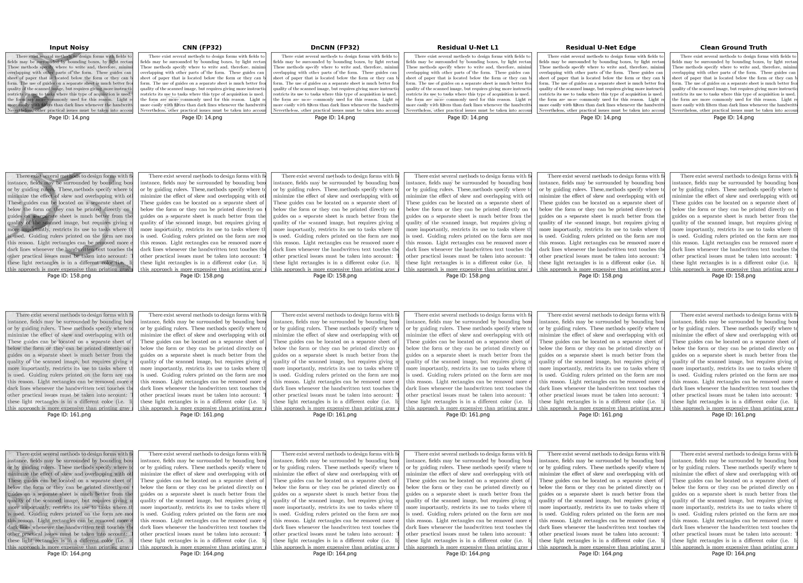
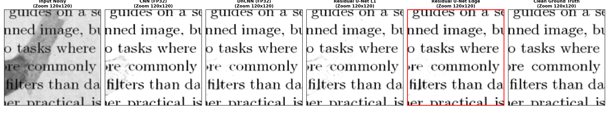
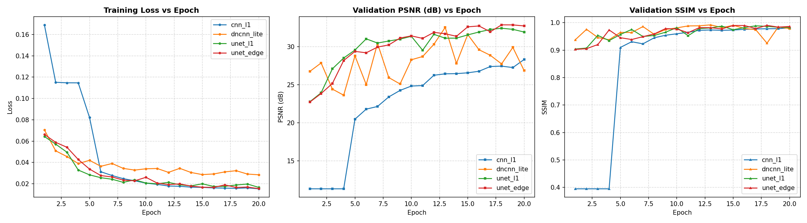

# Presentation Brief — AIE464 Text-Preserving Image Denoising

เอกสารสำหรับเพื่อนนำไปทำสไลด์ อ้างอิง [Final Notebook พร้อม outputs จริง](../mini_project/FINAL_SUBMISSION/aie464-text-preserving-image-denoising-final.ipynb) และ Final Artifacts ZIP ต้นฉบับในเครื่อง `mini_project/FINAL_SUBMISSION/aie464_final_artifacts.zip` เท่านั้น ตัวเลขตรวจจาก [Benchmark JSON](../mini_project/results/final/final_test_benchmark.json); ไม่มีผลสมมติหรือคะแนนจากรุ่นเก่า ZIP ไม่รวมใน Repository แต่มีข้อมูลสำหรับสไลด์ครบในสำเนาผลด้านล่าง

**ประโยคหลักสำหรับนำเสนอ:** “การเพิ่ม Sobel Edge Loss ให้ Residual U-Net เพิ่ม PSNR 0.360 dB และ SSIM 0.0036 เมื่อเทียบกับ U-Net ที่ใช้ L1 อย่างเดียวในชุดทดลองนี้ U-Net Edge ได้ PSNR สูงสุด ส่วน DnCNN-lite ได้ SSIM สูงสุด เรายังไม่ได้วัดว่าความแม่นยำ OCR ดีขึ้นหรือไม่”

## ลำดับสไลด์ที่แนะนำ

| สไลด์ | หัวข้อ | สารที่ควรให้ผู้ฟังจำ |
|---|---|---|
| 1 | Title & Problem | ลดคราบ/สัญญาณรบกวนในเอกสารพร้อมศึกษาการรักษาเส้นตัวอักษร |
| 2 | Objectives | เปรียบเทียบโมเดลและผลของ Edge Loss ภายใต้เงื่อนไขเดียวกัน |
| 3 | Dataset | 144 คู่ภาพจาก 36 กลุ่ม; แบ่งกลุ่มก่อน crop |
| 4 | Models & Methodology | 3 สถาปัตยกรรม, 4 configurations; U-Net สองแบบต่างที่ loss |
| 5 | Experimental Setup | T4, FP32, Seed 42, 20 Epochs, Adam, crop 256×256 |
| 6 | Results | PSNR สูงสุดคือ U-Net Edge; SSIM สูงสุดคือ DnCNN-lite |
| 7 | Visual Evidence — Full Page | เปรียบเทียบ input, ทุกโมเดล และภาพอ้างอิงในคู่เดียวกัน |
| 8 | Visual Evidence — Zoom | ดูพื้นหลังและเส้นตัวอักษรที่ crop ตำแหน่งเดียวกัน |
| 9 | Validation Curves | เลือก checkpoint จาก Validation PSNR ไม่ใช่ Test |
| 10 | Conclusion & Limitations | Edge Loss ช่วยคะแนนชุดนี้ แต่ยังไม่ยืนยัน OCR หรือการใช้งานทั่วไป |

## 1. Problem

**ข้อความบนสไลด์:** ภาพเอกสารที่มีคราบและสัญญาณรบกวนอ่านยาก การทำให้ภาพสะอาดต้องรักษารายละเอียดตัวอักษรด้วย

**คำอธิบายประกอบ:** Image Denoising คือการลดสัญญาณรบกวนในภาพ งานนี้รับ Grayscale ช่องเดียวและคืนภาพขนาดเดิม `1 × H × W → 1 × H × W` ปัญหาเรื่องตัวอักษรเป็นแรงจูงใจ ส่วนผลที่มีจริงเป็นตัวชี้วัดคุณภาพภาพและภาพเปรียบเทียบ

## 2. Objectives

1. เปรียบเทียบ Shallow CNN, DnCNN-lite และ Residual U-Net บนข้อมูลชุดเดียวกัน
2. ศึกษาว่าการเพิ่ม Sobel Edge Loss ซึ่งวัดความต่างของขอบภาพ ช่วย U-Net เมื่อเทียบกับ L1 Loss ซึ่งวัดความต่างของค่าพิกเซลหรือไม่
3. วัดคุณภาพภาพด้วย PSNR/SSIM พร้อมเวลาและหน่วยความจำระหว่าง evaluation

**ขอบเขตคำกล่าว:** Text Preservation เป็นการศึกษาขอบและรายละเอียดตัวอักษรจากภาพ ยังไม่มีผล OCR ยืนยันการอ่านข้อความ

## 3. Dataset

Kaggle input ที่ Final Notebook ใช้คือ `thames98451/aie464-denoising-benchmark` มีคู่ภาพ noisy/clean ใน `train/` และ `train_cleaned/` ตามคำอธิบายใน Notebook มี 144 คู่จาก 36 กลุ่มเอกสารต้นฉบับ กลุ่มละ 4 noisy variants

| ชุดข้อมูล | กลุ่มเอกสาร | คู่ภาพ |
|---|---:|---:|
| Train | 25 | 100 |
| Validation | 5 | 20 |
| Test | 6 | 24 |
| รวม | 36 | 144 |

**คำอธิบายบนสไลด์:** แบ่งระดับกลุ่มเอกสารก่อน crop และใช้รายชื่อจาก `split_manifest.json` เพื่อให้ทุกโมเดลใช้ชุดเดียวกัน ป้องกัน noisy variants ของเอกสารเดียวกันอยู่ข้ามชุด ซึ่งเป็น Data Leakage หรือข้อมูลรั่วระหว่างชุดฝึกกับชุดทดสอบ

ภาพแปลงเป็น Grayscale และปรับค่าพิกเซลเป็น `[0, 1]` ฝึกด้วย random crop 256×256 พิกเซลที่ noisy/clean ใช้พิกัดเดียวกัน ประเมิน Validation และ Test เต็มหน้า

**ควรเขียนว่า:** “Test 24 คู่ภาพจาก 6 กลุ่มเอกสาร” ไม่เขียนว่า “Test 24 เอกสารอิสระ”

## 4. Models และ Methodology

| Model | บทบาท | โครงสร้าง | Parameters | Loss |
|---|---|---|---:|---|
| `cnn_l1` | Baseline 1 | CNN 5 convolutions, width 16, Sigmoid | 7,265 | L1 |
| `dncnn_lite` | Baseline 2 | DnCNN-lite 7 convolutions, width 32, BatchNorm | 47,009 | L1 |
| `unet_l1` | U-Net ตัวเปรียบเทียบ | Residual U-Net, 3 encoder levels, width 16 | 487,009 | L1 |
| `unet_edge` | Proposed loss | Residual U-Net โครงสร้างเดียวกับ `unet_l1` | 487,009 | L1 + 0.1 × Sobel Edge Loss |

เป็น **4 configurations จาก 3 สถาปัตยกรรม** U-Net ทั้งสองมี skip connections หรือทางเชื่อมที่ส่งรายละเอียดจาก encoder ไป decoder และใช้ residual output เหมือน DnCNN-lite:

```text
Noisy image → Model predicts noise → Noisy image − predicted noise → Denoised image
```

CNN ทำนายภาพสะอาดโดยตรง ส่วน U-Net เติมขอบภาพเพื่อให้ลงตัวกับการลดขนาดภายในโมเดล แล้วตัดผลกลับให้เท่ากับ input

สูตรที่ใช้จริงใน Proposed configuration:

$$
\mathcal{L}_{total} = \mathcal{L}_{1} + 0.1\,\mathcal{L}_{Sobel\ Edge}
$$

Sobel Edge Loss เปรียบเทียบ gradient ของ prediction กับภาพสะอาดในสองทิศทาง โดย gradient ในที่นี้หมายถึงการเปลี่ยนความสว่างบริเวณขอบ **ไม่มี SSIM loss และไม่มี Attention ในโมเดลชุดสุดท้าย**

**ไฟล์อ้างอิง:** [Final Notebook](../mini_project/FINAL_SUBMISSION/aie464-text-preserving-image-denoising-final.ipynb) เป็นโค้ดทดลองจริง ส่วน [`src/`](../mini_project/src/) เป็น Development Pipeline รุ่นพัฒนาที่มี Architecture ต่างกัน โดย U-Net รุ่นนั้นใช้ Sigmoid output จึงไม่ใช้ `src/` อธิบายว่าเป็น implementation เดียวกับผล Final Benchmark

## 5. Experimental Setup

| รายการ | ค่าที่ใช้จริง |
|---|---|
| Framework / Hardware | PyTorch / Tesla T4 บน Kaggle ตาม output |
| Precision | FP32 — เลขทศนิยม 32 บิต; ไม่ใช้ AMP ในการฝึกชุดนี้ |
| Seed | 42; reset ก่อนฝึกแต่ละ configuration |
| Training | 20 Epochs ต่อ configuration; Epoch คือหนึ่งรอบผ่านข้อมูลฝึก |
| Optimizer / Learning rate | Adam / `1e-3` |
| Training batch / crop | 1 คู่ / 256×256 พิกเซล |
| Gradient clipping | Max norm 1.0 เพื่อจำกัดขนาด gradient |
| Validation | ครบ 20 คู่เต็มหน้าทุก Epoch |
| Best checkpoint | น้ำหนักโมเดล ณ Epoch ที่ Validation PSNR สูงสุด |
| Test | 24 คู่เต็มหน้าชุดเดียวกัน, batch size 1 |

ลำดับการทดลอง: Load data/split → Train → Validate ทุก Epoch → เลือก Best checkpoint → Test → สร้างตารางและภาพ → Export ZIP

PSNR คำนวณจาก MSE ซึ่งเป็นความคลาดเคลื่อนพิกเซลเฉลี่ยกำลังสอง: `−10 × log10(MSE)` ส่วน SSIM ใช้ Gaussian window 11×11, sigma 1.5 ทั้งสอง metrics คำนวณหลัง clamp ภาพเป็น `[0, 1]` แล้วเฉลี่ยคะแนนต่อคู่ภาพ

**Efficiency protocol:** Latency คือเวลา forward หนึ่งครั้งต่อคู่ รวม output clamp และ CUDA synchronization แล้วเฉลี่ย 24 คู่ ไม่รวมอ่านไฟล์ ส่งภาพเข้า GPU หรือคำนวณ metrics ไม่มี warm-up หรือ repeated timing ต่อภาพ Peak VRAM คือ PyTorch allocated-memory peak ระหว่าง evaluation ไม่ใช่ Training peak; สูตรหาร `1024**2` ให้หน่วย MiB แม้ต้นฉบับใช้ชื่อ MB

## 6. Results

ที่มา: [Benchmark JSON](../mini_project/results/final/final_test_benchmark.json) จาก Final ZIP ค่า ↑ ยิ่งสูงยิ่งดี; ค่า ↓ ยิ่งต่ำยิ่งดี

| Model | Best Epoch | Test PSNR ↑ (dB) | Test SSIM ↑ | Latency ↓ (ms/page) | Peak VRAM ↓ (MB) |
|---|---:|---:|---:|---:|---:|
| `cnn_l1` | 20 | 27.706 | 0.9810 | 3.65 | 39.8 |
| `dncnn_lite` | 13 | 31.669 | **0.9918** | 9.39 | 67.1 |
| `unet_l1` | 18 | 31.506 | 0.9862 | 6.92 | 116.5 |
| `unet_edge` | 18 | **31.865** | 0.9898 | 6.06 | 116.5 |

PSNR เป็นคะแนนคุณภาพพิกเซลในหน่วย dB; SSIM เป็นคะแนนความคล้ายโครงสร้างภาพ ปัดเป็น PSNR 3 ตำแหน่ง, SSIM 4 ตำแหน่ง, Latency 2 ตำแหน่ง และ VRAM 1 ตำแหน่ง ใช้ JSON หากต้องการตัวเลขเต็ม

**คำบรรยายผลพร้อมใช้:**

- `unet_edge` ได้ PSNR สูงสุด **31.865 dB** แต่ `dncnn_lite` ได้ SSIM สูงสุด **0.9918**
- เมื่อเทียบ U-Net โครงสร้างเดียวกัน Edge Loss เพิ่ม PSNR **0.360 dB** และ SSIM **0.0036** ในชุดทดลองนี้
- `cnn_l1` มี latency ต่ำสุด **3.65 ms/page** ส่วน `unet_edge` วัดได้ **6.06 ms/page** และ DnCNN-lite **9.39 ms/page** ตาม protocol ที่ระบุ
- ไม่มี configuration เดียวที่ชนะทุกตัวชี้วัด และยังไม่อ้างว่าความแตกต่างมีนัยสำคัญทางสถิติ

Validation logs สำหรับตรวจกราฟและ Best Epoch: [CNN](../mini_project/results/final/logs/cnn_l1/validation.json), [DnCNN-lite](../mini_project/results/final/logs/dncnn_lite/validation.json), [U-Net L1](../mini_project/results/final/logs/unet_l1/validation.json), [U-Net Edge](../mini_project/results/final/logs/unet_edge/validation.json)

## 7. Visual Evidence

ใช้ PNG เดิมจาก ZIP โดยไม่สร้างผลโมเดลใหม่ แนะนำแยกเต็มหน้า ภาพขยาย และกราฟคนละสไลด์เพื่อให้ตัวอักษรอ่านได้

### ภาพ A — Full-Page Comparison

[เปิด PNG ต้นฉบับ 3300×2400](../mini_project/results/final/qualitative_test_comparisons.png)



**Caption พร้อมใช้:** “ภาพเปรียบเทียบ 4 คู่ภาพตัวอย่างจาก Test Set เรียงจาก Input Noisy, CNN, DnCNN-lite, U-Net L1, U-Net Edge และ Clean Ground Truth หรือภาพสะอาดอ้างอิง ใช้คู่ภาพเดียวกันในแต่ละแถว”

คู่ภาพตัวอย่างตามลำดับใน Notebook: `14.png`, `158.png`, `161.png`, `164.png` เป็น 4 คู่ตัวอย่าง ไม่ใช่ผลภาพครบ 24 คู่หรือหลักฐานว่าเป็น 4 กลุ่มเอกสารอิสระ

**ชวนผู้ฟังดู:** ความสม่ำเสมอของพื้นหลัง คราบที่ยังเหลือ และรายละเอียดข้อความเทียบกับ Ground Truth

### ภาพ B — Text Zoom Comparison

[เปิด PNG ต้นฉบับ 3300×630](../mini_project/results/final/qualitative_zoom_comparisons.png)



**Caption พร้อมใช้:** “ภาพขยายบริเวณเดียวกันขนาด 120×120 พิกเซลจากคู่ภาพ `14.png` เปรียบเทียบทุก configuration กับ input และภาพสะอาดอ้างอิง”

**ชวนผู้ฟังดู:** พื้นหลังหลังลด noise และน้ำหนักเส้นตัวอักษร ใช้สนับสนุนการอภิปรายเชิงสายตา ไม่สรุปว่า U-Net Edge คมที่สุดทุกหน้า หรือ OCR อ่านได้ถูกต้องขึ้น

### ภาพ C — Training & Validation Curves

[เปิด PNG ต้นฉบับ 2700×750](../mini_project/results/final/training_validation_curves.png)



**Caption พร้อมใช้:** “Training Loss, Validation PSNR และ Validation SSIM ตลอด 20 Epochs ของทั้ง 4 configurations เลือก checkpoint จาก Validation PSNR สูงสุด: CNN Epoch 20, DnCNN-lite Epoch 13 และ U-Net ทั้งสอง Epoch 18”

กราฟเป็น Validation ไม่ใช่ Test ราย Epoch และ loss ของ U-Net Edge ต่างสูตรจาก L1 อย่างเดียว จึงไม่จัดอันดับจากระดับ Training Loss ข้ามสูตร

## 8. Conclusion

**ข้อความบนสไลด์สรุป:** “Sobel Edge Loss ช่วยเพิ่มคะแนนคุณภาพภาพของ Residual U-Net เมื่อเทียบกับ L1 อย่างเดียวในชุดทดลองนี้ U-Net Edge ได้ PSNR สูงสุด ขณะที่ DnCNN-lite ได้ SSIM สูงสุด การเลือกโมเดลจึงขึ้นกับตัวชี้วัดและทรัพยากรที่ต้องการ”

**คำพูดปิด:** “ผลที่ยืนยันได้คือคะแนนภาพและภาพเปรียบเทียบบน Test ชุดนี้ ขั้นต่อไปคือวัด OCR และทดสอบหลาย seeds/ข้อมูลชุดอื่น เพื่อประเมินประโยชน์ต่อการอ่านข้อความและความสามารถใช้งานทั่วไป”

## 9. Limitations

- **Text preservation:** ยังไม่มี OCR CER/WER ซึ่งเป็นอัตราความผิดพลาดของตัวอักษร/คำ หรือ Human Evaluation จึงไม่ยืนยันว่า OCR ดีขึ้น
- **Dataset size:** Test มี 6 กลุ่มเอกสารและ 24 noisy variants; คู่ในกลุ่มเดียวกันไม่ใช่ตัวอย่างอิสระทั้งหมด
- **Statistical evidence:** ผลชุดเดียว Seed 42 ไม่มีหลาย seeds หรือช่วงความเชื่อมั่นให้สรุปนัยสำคัญ
- **Efficiency:** วัด T4, batch 1, ไม่มี warm-up/repeated timing; ไม่แทน CPU, Edge Device, Production API หรือ Training VRAM
- **Generalization:** ไม่มีผลข้าม Dataset ในชุดหลักฐาน จึงไม่สรุปว่าใช้ได้กับทุกภาษา ฟอนต์ และสภาพเอกสาร
- **Reproduction:** งานทำเอกสารนี้ตรวจหลักฐานที่บันทึกไว้ ไม่ได้ Run All ซ้ำ และข้อมูลเวอร์ชันไลบรารีในหลักฐานยังไม่ครบ

## คำถามที่อาจถูกถาม

| คำถาม | คำตอบตามหลักฐาน |
|---|---|
| โมเดลไหนดีที่สุด? | U-Net Edge ได้ PSNR สูงสุด; DnCNN-lite ได้ SSIM สูงสุด; CNN ใช้เวลาต่อหน้าน้อยที่สุด |
| OCR ดีขึ้นหรือไม่? | ยังไม่ได้วัด OCR จึงตอบยืนยันไม่ได้ |
| ทำไมแบ่งกลุ่มก่อน crop? | เพื่อไม่ให้ variants ของเอกสารเดียวกันอยู่ข้าม Train/Validation/Test |
| Proposed model เปลี่ยนอะไร? | เทียบ U-Net โครงสร้างเดียวกันโดยเพิ่ม Sobel Edge Loss น้ำหนัก 0.1 |
| มี SSIM loss หรือ Attention หรือไม่? | ไม่มีในชุดสุดท้าย; SSIM เป็น metric เท่านั้น |
| พิสูจน์หรือไม่ว่าทำไม U-Net เร็วกว่า DnCNN-lite? | มีค่าที่วัดได้ แต่ไม่ได้แยกทดลองสาเหตุ จึงไม่สรุปเหตุผลเชิงสถาปัตยกรรมจากเวลานี้อย่างเดียว |
| Run All ใช้ดูผลงานอย่างเดียวได้หรือไม่? | ไม่ได้; Final Notebook ฝึกใหม่แล้วประเมิน Test ให้เปิด saved outputs สำหรับนำเสนอ |

## ชุดไฟล์ที่ส่งให้เพื่อน

ส่งเอกสารนี้พร้อมโฟลเดอร์ `mini_project/results/final/` โดยคงเส้นทาง relative เดิม หรือส่ง Project Root ที่มีทั้งสองส่วน ทำสไลด์จาก JSON/logs/PNG ได้โดยไม่ต้องใช้ Dataset หรือ checkpoints และไม่ต้องรัน Notebook

| ไฟล์ | ใช้สำหรับ |
|---|---|
| [Benchmark JSON](../mini_project/results/final/final_test_benchmark.json) | ตัวเลขเต็มของโมเดลทั้ง 4 |
| [CNN Validation log](../mini_project/results/final/logs/cnn_l1/validation.json) | Training Loss และ Validation ราย Epoch |
| [DnCNN-lite Validation log](../mini_project/results/final/logs/dncnn_lite/validation.json) | Training Loss และ Validation ราย Epoch |
| [U-Net L1 Validation log](../mini_project/results/final/logs/unet_l1/validation.json) | Training Loss และ Validation ราย Epoch |
| [U-Net Edge Validation log](../mini_project/results/final/logs/unet_edge/validation.json) | Training Loss และ Validation ราย Epoch |
| [Full-page PNG](../mini_project/results/final/qualitative_test_comparisons.png) | ภาพเปรียบเทียบ 4 คู่ตัวอย่าง |
| [Zoom PNG](../mini_project/results/final/qualitative_zoom_comparisons.png) | ภาพขยายบริเวณข้อความ |
| [Curves PNG](../mini_project/results/final/training_validation_curves.png) | กราฟการฝึก/Validation |

ไฟล์ทั้ง 8 คัดลอกตรงจาก ZIP และตรวจ byte/SHA256 เทียบกับ entry ต้นฉบับแล้ว SHA256 ของ Final ZIP ตรงกับไฟล์กำกับในเครื่อง `mini_project/FINAL_SUBMISSION/aie464_final_artifacts.zip.sha256`:

```text
f7d92b9abb4f81b38afeb940d5e7df3c04ed99a8678bc7a694624d5464ed5d6c
```

เตรียม Final Notebook และสำเนาผลทั้ง 8 ไฟล์สำหรับ GitHub แล้ว โดยใช้ Relative Path ยังไม่ได้ Push; หลังอนุมัติและ Push แล้วจึงจะเปิดเวอร์ชันนี้บน GitHub ได้ ไม่ต้องมี ZIP หรือ checkpoints เพื่อใช้ Brief ทำสไลด์ และไม่ได้เปลี่ยน Final Notebook, checkpoints หรือผลต้นฉบับ
