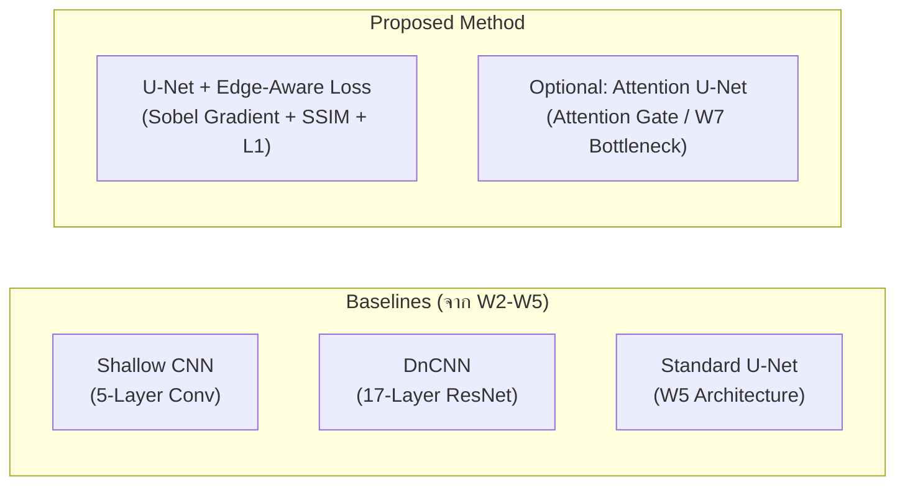

# Project Specification: Text-Preserving Image Denoising

> **เอกสารประวัติการวางแผน/พัฒนา:** เนื้อหาและสถานะด้านล่างบันทึกไว้ก่อนชุด Final และอาจต่างจาก implementation จริง ผลล่าสุดใช้ [Final Notebook](../mini_project/notebooks/final_colab.ipynb) และ [Improvement Report](IMPROVEMENT_REPORT.md) เป็นหลัก Notebook รุ่นพัฒนาที่กล่าวถึงเก็บไว้ในเครื่องและไม่รวมใน GitHub

> **วิชา:** AIE464 Applied Artificial Intelligence (Bangkok University)  
> **สถานะปัจจุบัน:** 🟡 **Specification & Planning Phase** (ยังไม่มีผลการ Train หรือ Benchmark จริง)

---

## 1. บริบทและเกณฑ์ประเมิน AIE464 (4 Core Criteria)

โปรเจกต์นี้ตอบโจทย์เกณฑ์การประเมิน 4 ข้อหลักของอาจารย์ผู้สอน:

| ข้อกำหนดอาจารย์ | การตอบโจทย์ในโปรเจกต์ Text-Preserving Image Denoising |
|---|---|
| **1. ปัญหาบน Data (Problem Statement)** | การสูญเสียคุณภาพของเอกสารสแกนและภาพถ่ายเอกสารจากคราบสกปรก รอยยับ และ Noise ซึ่งส่งผลโดยตรงให้ระบบ OCR หรือการจัดเก็บเอกสารล้มเหลว |
| **2. ข้อมูลเชิงลึก & วิธีการนำเสนอ (Insights & Proposed Method)** | **Insight:** โมเดล Denoising ดั้งเดิมที่ใช้ $L_1$/MSE Loss มีแนวโน้มทำภาพเบลอ (Oversmoothing) ทำให้ขอบตัวอักษรบาง ๆ ขาดหาย **Proposed Solution:** ออกแบบ **Edge-Aware Composite Loss** (ผสม Sobel Gradient Loss + SSIM + $L_1$) เพื่อบังคับให้โครงข่ายรักษารายละเอียดขอบเส้นตัวหนังสือ |
| **3. โมเดลเปรียบเทียบจากบทเรียน W2–W7 (PyTorch Baselines)** | พัฒนาด้วย PyTorch และเปรียบเทียบกับโมเดลที่เรียนมาอย่างน้อย 2–3 ตัว: • **Baseline 1:** Shallow CNN Denoiser (CNN พื้นฐานจาก W2) • **Baseline 2:** DnCNN (Residual CNN Denoiser จาก W2/W4) • **Baseline 3:** Standard U-Net (จาก W5 `W5_2_U_net_lung_segmentation.ipynb`) • **Proposed Model:** U-Net + Edge-Aware Loss (และเสริม Attention หากเวลาเอื้ออำนวย) |
| **4. ผลเปรียบเทียบครอบคลุม (Comprehensive Benchmarks)** | วัดผลครบ 3 มิติ: Quantitative (PSNR, SSIM, OCR CER), Qualitative (ตาราง Side-by-side ซูม Crop ขอบอักษร), และ Efficiency (Latency ms, GPU VRAM) |

---

## 2. การเชื่อมโยงเนื้อหาในรายวิชา (Week 2 – Week 7)

- **Week 2 (CNN Fundamentals):** สถาปัตยกรรม Convolution, Activation Function และโครงสร้าง Feedforward เบื้องต้น (ใช้ใน Shallow CNN)
- **Week 3 (DL Optimization & Regularization):** การปรับปรุง Loss Function, การจัดสมดุล Multi-task Loss ($\lambda$), Weight Decay, และ AdamW Optimizer
- **Week 4 (SOTA & Lightweight CNNs):** แนวคิด Residual Learning (DnCNN / ResNet blocks) และ Depthwise Convolutions
- **Week 5 (CNN Applications - U-Net & Segmentation):** สถาปัตยกรรม Encoder-Decoder พร้อม Skip Connection ซึ่งเป็นกระดูกสันหลังหลักของโมเดลเรา
- **Week 7 (Transformers & Attention):** *(ส่วนต่อขยายทางเลือก - Optional)* หากมีเวลาเพียงพอ สามารถนำ `MultiHeadAttentionBlock` มาใส่ในชั้น Bottleneck หรือใส่ Attention Gates ใน Skip Connections เพื่อตัด Noise บนพื้นกระดาษขาว

---

## 3. สถาปัตยกรรมโมเดลและแนวทางปรับปรุง (Model Pipeline)

### รายละเอียดการปรับปรุง (Proposed Improvement)
1. **Core Improvement (หลัก):** คงโครงสร้าง U-Net จาก W5 แต่เปลี่ยนวิธีคำนวณ Objective ในการฝึกสอน:
   $$\mathcal{L}_{\text{total}} = \alpha \mathcal{L}_1 + \beta (1 - \text{SSIM}) + \gamma \|\nabla_{\text{Sobel}}(\hat{I}) - \nabla_{\text{Sobel}}(I)\|_1$$
   - $\mathcal{L}_1$: รักษาค่าความสว่างระดับ Pixel
   - $\text{SSIM}$: รักษาโครงสร้างและความสอดคล้องระดับ Patch
   - $\nabla_{\text{Sobel}}$: รักษาขอบเส้นความชันของตัวอักษรไม่ให้เบลอ
2. **Stretch Goal (ทางเลือกเสริม):** เพิ่ม Attention Mechanism เพื่อคัดกรองสัญญาณรบกวนก่อนรวมฟีเจอร์ใน Decoder

---

## 4. แผนการวัดผลที่ยุติธรรม (Fair Benchmark Protocol)

- **Test Set ที่ใช้ร่วมกัน:** ทุกโมเดลจะต้องถูกประเมินบน **Test Split เดียวกัน (24 หน้าเอกสารที่ไม่เคยผ่านการ Train)**
- **ตัวชี้วัด (Metrics):**
  1. **PSNR (Peak Signal-to-Noise Ratio):** วัดคุณภาพการลดสัญญาณรบกวนในภาพรวม (dB)
  2. **SSIM (Structural Similarity Index):** วัดความคล้ายคลึงของโครงสร้างภาพ ($0-1$)
  3. **OCR Character Error Rate (CER):** นำภาพ Cleaned รันผ่าน Tesseract OCR เทียบกับ Ground Truth Text เพื่อพิสูจน์ประโยชน์ต่อ Downstream Task
  4. **Efficiency:** Inference Latency ต่อภาพ (ms) และ Peak GPU VRAM (MB) บน Google Colab T4
- **การแสดงผลเชิงสายตา (Qualitative Grid):** จัดทำภาพเปรียบเทียบแบบ Side-by-side พร้อมขยาย Bounding Box สีแดงเฉพาะจุดที่มีตัวหนังสือขนาดเล็ก
