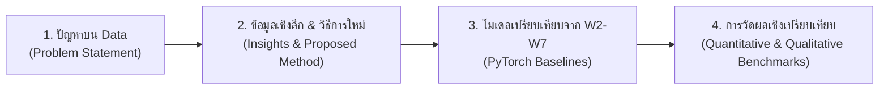
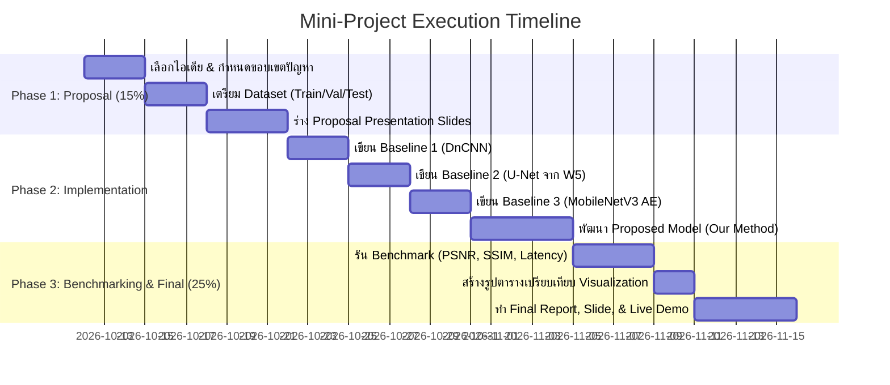

# AIE464 Mini-Project Specification: Image Denoising

> **เอกสารแนวคิดเดิม:** เนื้อหาด้านล่างเป็นแผนก่อนชุด Final ผลและวิธีที่ใช้จริงดู [Final Notebook](FINAL_SUBMISSION/aie464-text-preserving-image-denoising-final.ipynb) และ [Improvement Report](../docs/IMPROVEMENT_REPORT.md) รายชื่อชั้นเรียนหรือเอกสารส่วนตัวที่กล่าวถึงไม่รวมใน Repository

> **เอกสารสรุปข้อกำหนด ขอบเขตงาน และแนวทางการพัฒนา Mini-Project**  
> **วิชา:** AIE464 Applied Artificial Intelligence (Bangkok University)  
> **หัวข้อที่เลือก (Selected Task):** Image Denoising (การลดสัญญาณรบกวนในภาพ)  
> **สัดส่วนคะแนน:** Midterm Presentation (Proposal) 15% | Final Presentation, Report & Demo 25%

---

## 1. บริบทและวัตถุประสงค์ของโครงงาน (Project Overview)

เป้าหมายหลักตามเกณฑ์วิชา AIE464 คือการนำ **Deep Learning Model (PyTorch-based)** มาประยุกต์ใช้เพื่อแก้ปัญหาในโจทย์เฉพาะทาง โดยต้อง:
1. ปรับปรุงโมเดลให้มี **ความทนทาน (Robustness), ประสิทธิภาพ (Effectiveness), และความเร็ว/การใช้ทรัพยากร (Efficiency)** ที่ดีกว่าโมเดล Baseline เดิมอย่างเห็นได้ชัด
2. ผสมผสาน 3 เทคนิคสำคัญที่เรียนในคอร์ส:
   - **Transfer Learning:** การถ่ายโอนความรู้จาก Pretrained weights
   - **Model Compression:** การลดขนาดโมเดล/ความซับซ้อน (เช่น Lightweight backbone, Depthwise Separable Convolutions, Pruning, Quantization)
   - **Model Optimization:** การปรับจูน Optimizer, Learning Rate Scheduler, Loss Function ผสมผสาน และ Regularization (ตามเนื้อหา Week 3)
3. มีการทดสอบความแตกต่างของโดเมนข้อมูล (**Domain Shift / Source vs. Target Domain**) เช่น Train บน Synthetic Noise แต่ Test บน Real-world Sensor Noise

---

## 2. ถอดรหัสเกณฑ์ประเมิน 4 ข้อหลักของอาจารย์ (นำมาแมปกับ Image Denoising)

จากประกาศของอาจารย์ (8 ต.ค. และตัวอย่างภาพ `ODbenchtest.png`) โครงงานต้องตอบโจทย์ 4 ส่วนหลักดังนี้:



### ข้อที่ 1: เสนอปัญหาของ Mini-Project บน Data ให้ชัดเจน (Problem Statement)
* **เกณฑ์:** ห้ามทำ Denoising ลอยๆ บนรูปทั่วไป ต้องระบุว่า "ทำกับข้อมูลอะไร เพื่อแก้ปัญหาอะไรในชีวิตจริง"
* **การแมปกับ Image Denoising:** 
  * ระบุที่มาของสัญญาณรบกวน (Noise Source) เช่น สัญญาณรบกวนในที่แสงน้อย (Low-Light Poisson-Gaussian Noise), สัญญาณรบกวนในภาพถ่ายทางการแพทย์ (Low-Dose CT / Ultrasound Speckle), หรือภาพจากกล้องวงจรปิดกลางคืน (Night-time Surveillance Noise)
  * ชี้ให้เห็นว่าถ้านอยส์ไม่ถูกกำจัด จะส่งผลเสียต่อ Downstream Task อย่างไร (เช่น มองไม่เห็นรายละเอียดทางกายวิภาค, กล้องตรวจจับป้ายทะเบียนรถหรือใบหน้าคนผิดพลาด)

### ข้อที่ 2: ข้อมูลเชิงลึกและวิธีการที่นำเสนอว่าดีกว่างานก่อนหน้าอย่างไร (Insights & Proposed Method)
* **เกณฑ์:** วิเคราะห์คอขวด (Bottleneck) หรือข้อจำกัดของโมเดลเดิม และเสนอเทคนิค/แนวทางของเรามาแก้
* **ข้อจำกัดของโมเดลเดิมใน Image Denoising:**
  1. *Traditional Filters / Simple CNNs (เช่น DnCNN):* ขาด Receptive Field กว้างๆ ไม่สามารถจับ Global Context ทำให้ไม่เข้าใจโครงสร้างภาพขนาดใหญ่
  2. *Standard U-Net (จาก Week 5):* การใช้ Skip Connection แบบเดิมอาจส่งผ่านนอยส์จาก Encoder ไป Decoder ตรงๆ ทำให้ภาพผลลัพธ์ยังเหลือนอยส์หลงเหลือ และการใช้ Loss ปกติ (MSE / L2) ทำให้ภาพเกิด **Oversmoothing (ภาพเบลอ สูญเสีย High-frequency Texture & Edges)**
  3. *Heavy SOTA Denoisers (เช่น SwinIR, Restormer เต็มรูปแบบ):* กิน Compute และ Memory สูงมาก (FLOPs มหาศาล) ไม่สามารถรันบน Edge Device หรือ Inference แบบ Real-time ได้
* **วิธีการที่เรานำเสนอ (Our Proposed Solution):**
  * **Architecture Modification:** ออกแบบ **Attention U-Net** หรือ **Mobile Inverted Bottleneck U-Net (ResUNet / Mobile-UNet)** ดึงเอา Inverted Residual Block จาก Week 4 มาลด FLOPs + เสริม Self-Attention / Channel Attention เพื่อคัดกรองสัญญาณที่ดี
  * **Composite Loss Function:** ใช้ $L_{total} = \alpha L_1 + \beta L_{SSIM} + \gamma L_{Perceptual}$ (Feature Loss จาก VGG/ResNet) เพื่อรักษาขอบภาพและความคมชัดของพื้นผิว แทนที่จะใช้แค่ Pixel-wise MSE

### ข้อที่ 3: โมเดลที่ใช้และโมเดลเปรียบเทียบจาก Week 2 - Week 7 (Model Comparison)
* **เกณฑ์:** พัฒนาด้วย **PyTorch-based library** และต้องมี Baseline Models อย่างน้อย 2-3 โมเดลที่เชื่อมโยงกับสิ่งที่เรียนใน Week 2 - Week 7
* **โมเดลที่เชื่อมโยงจากบทเรียน AIE464:**

| ระดับ | โมเดล | ที่มาในบทเรียน | หน้าที่ในการทดลอง |
|---|---|---|---|
| **Baseline 1** | **DnCNN / Plain CNN Autoencoder** | Week 2 (CNN Basics) | โมเดลพื้นฐานวัดความสามารถของ Convolution ธรรมดา |
| **Baseline 2** | **Standard U-Net** | Week 5 (`W5_2_U_net_lung_segmentation.ipynb`) | โมเดล Encoder-Decoder ยอดนิยม (ปรับจาก 1-ch Mask เป็น 3-ch Denoised Image) |
| **Baseline 3** | **ResNet / MobileNetV3 Autoencoder** | Week 4 (`W4_1_SOTA Performance and Lightweight Model.ipynb`) | โมเดลที่ใช้ Lightweight Backbone ทดสอบเรื่อง Latency และ Model Compression |
| **Proposed Model** | **Our Improved Model**<br>*(เช่น Lightweight Attention-ResUNet)* | ออกแบบเพิ่มจาก W4 + W5 + W7 | โมเดลที่เราเสนอ ปรับจูนทั้งสถาปัตยกรรม, Loss, และ Optimization |

### ข้อที่ 4: ผลเชิงเปรียบเทียบและการแสดงผลอย่างครอบคลุม (Comprehensive Benchmarks)
* **เกณฑ์:** แสดงทั้งตัวเลข (Quantitative) และภาพเปรียบเทียบ (Qualitative Visualizations) แบบเดียวกับตัวอย่าง `ODbenchtest.png`
* **ตัวชี้วัดเชิงปริมาณ (Quantitative Metrics):**
  1. **Image Restoration Quality:**
     - **PSNR (Peak Signal-to-Noise Ratio)** (หน่วย dB): ยิ่งสูงยิ่งดี
     - **SSIM (Structural Similarity Index Measure)** (ค่า 0 - 1): วัดโครงสร้างและความสอดคล้องกับตามนุษย์
     - **LPIPS (Learned Perceptual Image Patch Similarity)** (ยิ่งต่ำยิ่งดี): วัดความสมจริงในเชิง Perceptual
  2. **Efficiency & Computational Resources:**
     - **Inference Latency** (ms per image หรือ FPS)
     - **Model Parameters** (Millions: M)
     - **FLOPs / GMACs** (ความซับซ้อนเชิงคำนวณ)
* **การแสดงผลภาพเปรียบเทียบ (Qualitative Benchmark Grid - ดัดแปลงจากอาจารย์):**
  - จัดทำภาพตารางเปรียบเทียบแบบ Side-by-side:
    ```
    [Noisy Input] | [DnCNN] | [Standard U-Net] | [MobileNet-AE] | [Our Proposed Model] | [Ground Truth (Clean)]
    ```
  - พร้อมทำ **Zoom-in Bounding Box (Crop Patch ขยาย)** บริเวณที่มีเส้นขอบ (Edges) หรือ Texture ละเอียด เพื่อพิสูจน์ว่าโมเดลเราไม่ทำให้ภาพเบลอเหมือนโมเดลอื่น

---

## 3. ข้อเสนอแนะ 4 ไอเดียหัวข้อ Mini-Project (Project Ideas for Selection)

เพื่อให้กลุ่มสามารถเลือกไปทำ Proposal ได้อย่างมั่นใจ นี่คือ 4 ไอเดียที่ตรงสเปกวิชาและมี Dataset พร้อมใช้งาน:

---

### 🌟 ไอเดียที่ 1: Real-World Smartphone Low-Light Denoising (แนะนำสูงสุด ⭐⭐⭐⭐⭐)
* **โจทย์ปัญหา:** กล้องสมาร์ตโฟนเมื่อถ่ายในที่แสงน้อยจะมีเซนเซอร์ขนาดเล็ก เกิด High ISO Noise (Poisson-Gaussian Noise) รุนแรง ทำให้ภาพสูญเสียรายละเอียดและสีสันเพี้ยน
* **Dataset ที่ใช้:** 
  - **SIDD (Smartphone Image Denoising Dataset)** หรือ **LOL (Low-Light Dataset)** (มีคู่ภาพ Noisy-Clean คุณภาพสูง)
* **โมเดลของเรา (Proposed):** **Lightweight Dual-Domain / Attention-UNet** ที่ผสาน Depthwise Separable Conv (จาก W4) ร่วมกับ Channel Attention
* **จุดเด่น:** ทำได้จริง เห็นภาพผลลัพธ์ Before/After ชัดเจนมาก ตอบโจทย์ Model Compression เพราะต้องรันบนมือถือ

---

### 🏥 ไอเดียที่ 2: Medical Imaging Denoising: Low-Dose CT / Chest X-Ray (แนะนำ ⭐⭐⭐⭐)
* **โจทย์ปัญหา:** การถ่าย CT Scan ปริมาณรังสีต่ำ (Low-Dose CT) ช่วยลดความเสี่ยงมะเร็งจากรังสีของผู้ป่วย แต่ภาพที่ได้จะมี Quantum Noise สูงมาก บดบังรอยโรคของแพทย์
* **Dataset ที่ใช้:** 
  - **COVID-19 Radiography Dataset** (มีอยู่ในโฟลเดอร์ `W5/Datasets/COVID-19_Radiography_Dataset.zip` ของวิชานี้อยู่แล้ว!) โดยสามารถใส่ Synthetic Noise หลากหลายระดับ หรือใช้ Mayo Clinic Low-Dose CT Challenge
* **โมเดลของเรา (Proposed):** **Res-UNet with Edge-Preserving Perceptual Loss**
* **จุดเด่น:** สามารถใช้ Dataset ที่มีอยู่แล้วในโฟลเดอร์ Week 5 มาต่อยอดได้ทันที ประหยัดเวลาโหลดข้อมูล และมีประโยชน์ทางการแพทย์สูง

---

### 🚗 ไอเดียที่ 3: Night-time Traffic Surveillance Camera Denoising (แนะนำ ⭐⭐⭐⭐)
* **โจทย์ปัญหา:** กล้องวงจรปิดตามท้องถนนช่วงเวลากลางคืนมีสัญญาณรบกวนสูงมาก ทำให้ระบบ AI ตรวจจับรถยนต์ (Object Detection) หรืออ่านป้ายทะเบียน (LPR) ล้มเหลว
* **Dataset ที่ใช้:** 
  - **ExDark Dataset** (Exclusively Dark Dataset) หรือ NightSurveillance Datasets
* **โมเดลของเรา (Proposed):** **Fast-DenoiseNet for Pre-detection Enhancement** (Denoising โมเดลขนาดเล็กที่มี Latency ต่ำกว่า 15ms เพื่อส่งต่อให้ YOLOv8 ทำงานต่อได้)
* **จุดเด่น:** เชื่อมโยงกับตัวอย่างของอาจารย์ (`ODbenchtest.png`) ได้อย่างสมบูรณ์แบบ แสดงให้เห็นผลกระทบของ Denoising ต่อ mAP ของ YOLO

---

### 🔬 ไอเดียที่ 4: Fluorescence Microscopy Image Denoising (แนะนำ ⭐⭐⭐)
* **โจทย์ปัญหา:** กล้องจุลทรรศน์ฟลูออเรสเซนต์ในการทดลองชีววิทยา ต้องใช้แสงเลเซอร์พลังงานต่ำเพื่อป้องกันไม่ให้เซลล์ตาย (Phototoxicity) ส่งผลให้ภาพเซลล์มี Noise สูงมาก
* **Dataset ที่ใช้:** 
  - **FMD (Fluorescence Microscopy Denoising Dataset)** (มีภาพเซลล์จริง Raw Noisy กับ Averaged Clean Ground Truth)
* **โมเดลของเรา (Proposed):** **Noise2Void / Self-Supervised U-Net** หรือ **Attention U-Net**
* **จุดเด่น:** เป็นงานวิจัยระดับสูง โชว์ความลึกซึ้งทางเทคนิค เหมาะกับงานสายวิชาการ

---

## 4. แผนการดำเนินงานและ Checklist สำหรับส่งงาน (Roadmap & Milestones)



### Checklist สำหรับ Midterm Proposal (สัดส่วน 15%):
- [ ] ระบุหัวข้อและชื่อโปรเจกต์ที่ชัดเจน (เช่น *"Lightweight Attention-Guided U-Net for Real-Time Smartphone Low-Light Denoising"*)
- [ ] สไลด์นำเสนอปัญหาและความสำคัญ (Motivation & Problem Statement on Data)
- [ ] สไลด์วิเคราะห์ข้อจำกัดของงานเดิม (Limitations of Previous Works)
- [ ] สไลด์นำเสนอ Architecture ของโมเดลเรา และเทคนิคปรับปรุง (Proposed Methodology: Architecture + Loss + Optimization)
- [ ] สไลด์แผนการทดลอง: รายละเอียด Dataset, รายชื่อ Baseline Models (อย่างน้อย 2-3 ตัว), และ Metrics ที่ใช้วัดผล

---

## 5. โครงสร้างโฟลเดอร์โปรเจกต์ที่แนะนำ (Project Directory Layout)

```
mini_project/
├── PROJECT_SPEC.md              # ไฟล์นี้ (สรุปข้อกำหนดและบริบทโปรเจกต์)
├── README.md                    # สรุปภาพรวมและวิธีการรันโค้ด
├── ODbenchtest.png              # ตัวอย่างเกณฑ์ของอาจารย์
├── _AIE464_Project-Assignment_grouplist.xlsx
├── data/                        # โฟลเดอร์เก็บข้อมูล
│   ├── raw/                     # ข้อมูลดิบ (Noisy / Clean)
│   └── processed/               # ข้อมูลที่ผ่านการ Split และ Preprocess แล้ว
├── src/                         # ซอร์สโค้ด PyTorch
│   ├── dataset.py               # PyTorch Dataset & Dataloader (Data Augmentation)
│   ├── models/                  # สถาปัตยกรรมโมเดล
│   │   ├── dncnn.py             # Baseline 1
│   │   ├── unet.py              # Baseline 2 (จาก Week 5)
│   │   ├── mobilenet_ae.py      # Baseline 3 (Lightweight จาก Week 4)
│   │   └── proposed_model.py    # Proposed Model ของกลุ่มเรา
│   ├── losses.py                # Loss Functions (L1 + SSIM + Perceptual Loss)
│   ├── train.py                 # สคริปต์ฝึกสอนโมเดลพร้อม Checkpoint
│   └── benchmark.py             # คำนวณ PSNR, SSIM, Latency, FLOPs
├── notebooks/                   # Jupyter Notebooks สำหรับการทดลอง / Demo
│   └── 01_denoising_benchmark.ipynb
├── outputs/                     # ผลลัพธ์
│   ├── checkpoints/             # Saved PyTorch .pth weights
│   └── visual_comparisons/      # รูปภาพเปรียบเทียบแบบ ODbenchtest.png
└── presentation/                # ไฟล์สไลด์นำเสนอ (Midterm & Final)
```

---

## 6. สรุปความพร้อมสำหรับแชทครั้งต่อไป (Context for Future Conversations)

* เมื่อผู้ใช้งานหรือเพื่อนในกลุ่มเข้ามาในแชทครั้งถัดไป **สามารถพิมพ์บอกไอเดียที่เลือก (เช่น "เลือกไอเดียที่ 1 Smartphone Low-Light Denoising") ได้ทันที**
* AI จะสามารถหยิบสเปกในไฟล์นี้มาเริ่มเขียนโค้ด PyTorch:
  1. สร้าง DataLoader สำหรับโหลดภาพ Noisy/Clean
  2. สร้างสถาปัตยกรรมโมเดล Baseline จาก Week 4 และ Week 5
  3. ออกแบบและพัฒนา Proposed Model
  4. ทำสคริปต์ Benchmark คำนวณตารางตัวเลขและสร้างรูปภาพเปรียบเทียบแบบใน `ODbenchtest.png` ให้พร้อมนำเสนออาจารย์ได้ครบถ้วนตามเกณฑ์ 100%
